<h1 align="center">Paget96 Garage: BMW iDrive 7 (MGU) apps</h1>

<p align="center">
  
</p>

<p align="center">
  <b>Five apps for the BMW iDrive 7 head unit: live engine data, a full car health check, the exhaust flap under your control, a calm clock and the car's lights.</b><br>
  One modern look, drawn by the GPU at 60 fps, installed and updated from the MGU Store.
</p>

<p align="center">
  
  
  
  
</p>
<p align="center">
  
  
  
  
</p>

<p align="center">
  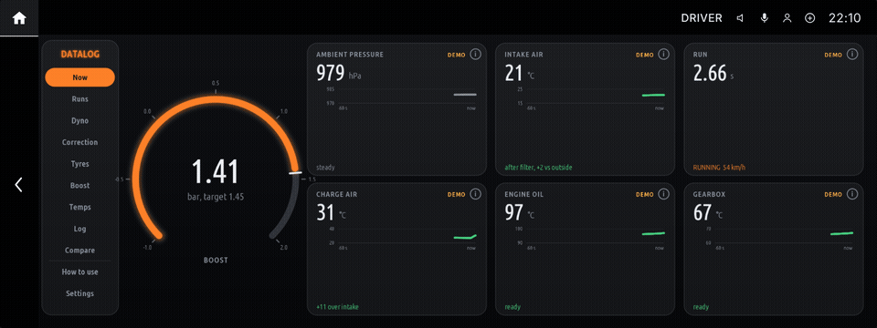
  <br><sub>Live in the iDrive 7 screen (1920 x 720): Datalog, Exhaust, Health and Standby, demo values marked DEMO.</sub>
</p>

| What you see live | |
|---|---|
| **Boost** against its target, intake and charge air, oil, coolant and gearbox temperatures | Datalog |
| **0 to 100, 402 m, trap speed**, weather corrected times and a dyno sheet from your own runs | Datalog |
| **Exhaust after the catalyst, particulate filter load and soot**, the flap's state and your own flap rules | Exhaust |
| **Every control unit's faults** with freeze frames, misfires per cylinder, lambda, VANOS, battery, service, tyres | Health |
| A calm **clock** with outside temperature, battery and range for waiting and night drives | Standby |

> **Status, November 2026:** Health, Datalog, Exhaust and Standby are built and run on the developer's own car
> (BMW G20, B48 engine, iDrive 7): touch, the side menu and live values are checked there. Still a preview until the
> first release: report what you see with **Send a report** in each app's Settings.

**Made by Danijel Markov (Paget96).** Follow the work and talk to us:
[Instagram](https://www.instagram.com/thedakiness/) ·
[TikTok](https://www.tiktok.com/@paget96) ·
[X](https://x.com/Paget96) ·
[Telegram channel](https://t.me/paget96_projects_channel) ·
[Telegram group](https://t.me/Paget96_Projects) ·
[paget96projects.com](https://paget96projects.com) ·
[GitHub](https://github.com/Paget96)

## Contents

- [Install](#install)
- [The apps](#the-apps)
- [Gallery](#gallery)
- [How every app works](#how-every-app-works)
- [Send a report](#send-a-report)
- [Our renderer](#our-renderer)
- [Building](#building)
- [Contributing](#contributing)
- [Follow](#follow)
- [Credits](#credits)
- [Disclaimer](#disclaimer)
- [License](#license)

## Install

### From the MGU Store (recommended)

The Store builds each app on the head unit straight from this repository.

1. Open the MGU Store on the head unit.
2. Settings, **Add source**, then type `Paget96/Paget96-Garage`.
3. Pick an app from the list and install it.

Updates arrive in the Store like any other source's. The Store installs the Garage renderer
([Our renderer](#our-renderer)) with the first app.

### Manual

For development only: build a package on a PC (see [Building](#building)) and install the
`dist/<id>@<version>.tgz` with the MGU Store's stick or deploy tool, as its
[publishing guide](https://github.com/robertnisipeanu/mgu-store/blob/main/docs/PUBLISHING.md)
describes.

## The apps

| | App | What it does |
|---|---|---|
|  | [Health](#p96_health) | One look at the whole car: faults with their history, 12 V battery, service, tyres, fluids, a score and a report to share |
|  | [Datalog](#p96_datalog) | 402 m runs with splits and weather corrected times, a dyno sheet, boost, the air, tyres, temperatures, a log and two runs compared |
|  | [Standby](#p96_standby) | A calm clock for waiting and night drives, the car at a glance, this drive and today |
|  | [Exhaust](#p96_exhaust) | The exhaust live, the flap with your own rules, the particulate filter and its regenerations, and a better sound without changing anything |

## Gallery

<table>
<tr>
<td width="50%">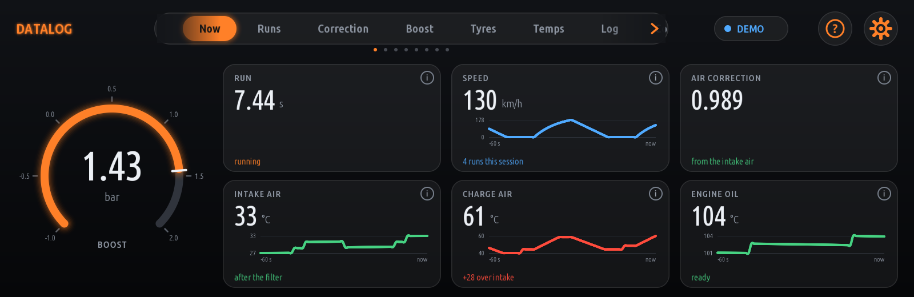<br><b>Datalog</b>: boost against its target, air and temperatures live</td>
<td width="50%"><br><b>Datalog</b>: tyre pressures and temperatures on the car from above</td>
</tr>
<tr>
<td>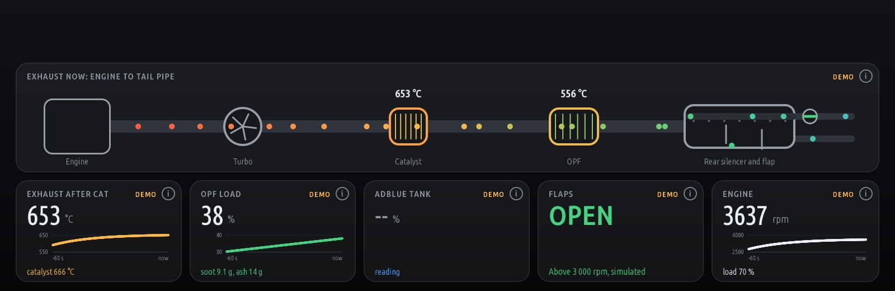<br><b>Exhaust</b>: engine to tail pipe, catalyst and filter temperatures, flap</td>
<td>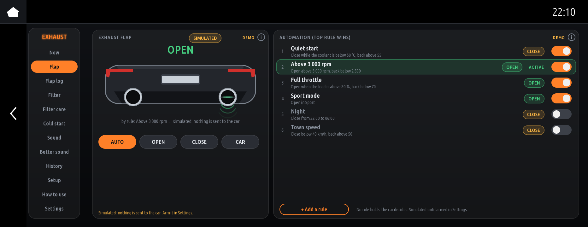<br><b>Exhaust</b>: the flap with AUTO rules, OPEN, CLOSE and CAR</td>
</tr>
<tr>
<td><br><b>Health</b>: one score for the whole car</td>
<td>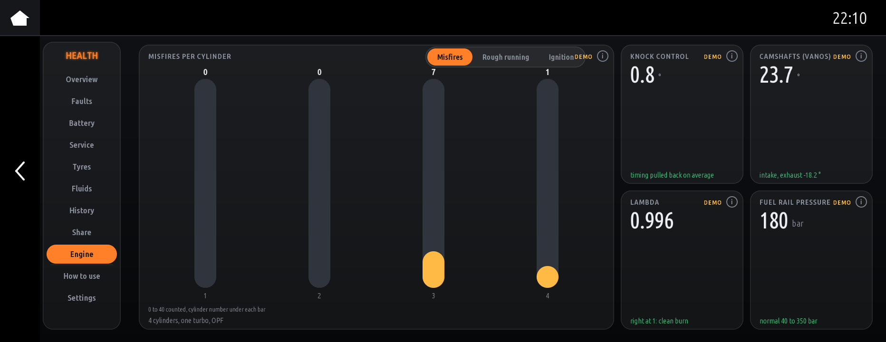<br><b>Health</b>: misfires per cylinder, knock control, VANOS, lambda</td>
</tr>
<tr>
<td><br><b>Standby</b>: the calm clock</td>
<td>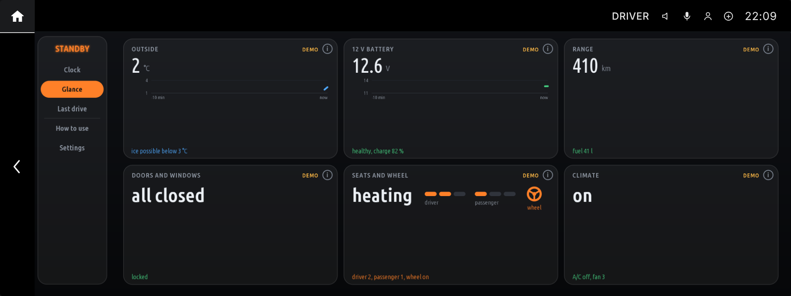<br><b>Standby</b>: the car at a glance</td>
</tr>
</table>

<!--
One row per app, in this form:
| /icon.png" width="48"> | [<Name>](#<id>) | one line |

Then one section per app, in this form (and the same text in apps/<id>/README.md):

<a id="<id>"></a>
### <Name>

What it is for, in two or three sentences.


| Page | Screenshot |
|---|---|
| <page> |  |

**What it reads from the car:** the signals, in plain words.
**Limits:** what it cannot do.
**Settings:** each setting and what it changes.

tools/check_docs.py fails the build when an app has no section, no GIF or no screenshot.
-->

<a id="p96_datalog"></a>
### Datalog

Your car's strip day in one app. Datalog times 201 m, 402 m and 1/2 mile runs from a standstill, with 0 to 100 km/h,
60 to 100 km/h, 201 m, the trap speed and your reaction, and corrects every time to standard air (SAE J1349) so runs
on different days compare fairly. Next to that: a dyno sheet from a full throttle pull, the boost and the wastegate, the three air
temperatures from the mirror to the throttle, the tyres from cold to hot, the fluids, a log of every run and two runs
side by side.

Datalog shows only what your car reports: a page, card, chart line or setting appears once your car has sent that
value (remembered for this car). Demo data shows everything a car of the chosen Demo car has.


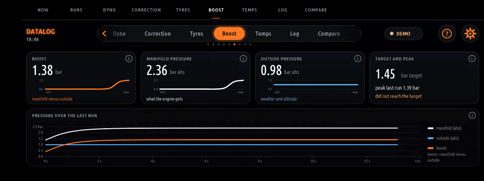

| Page | Screenshot |
|---|---|
| Now: boost, the air, the run, oil and gearbox |  |
| Runs: the last run and every run today |  |
| Dyno: power and torque over the rev range |  |
| Correction: three air temperatures, pressure, the SAE factor |  |
| Tyres: pressure and temperature, cold to hot |  |
| Boost: manifold minus outside, target and peak, the wastegate |  |
| Temps: oil, coolant, gearbox, air, exhaust, 10 minutes |  |
| Log: sessions and their runs | 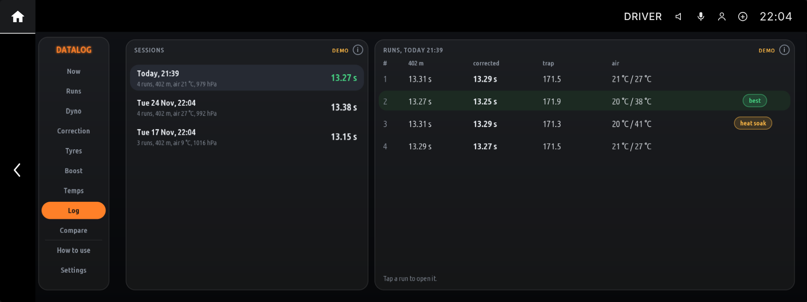 |
| Log: a run opened |  |
| Compare: two runs, every split, boost, charge air, the air |  |
| Info popup: boost, animated |  |
| Info popup: charge air, the air path |  |
| Info popup: the dyno sheet | 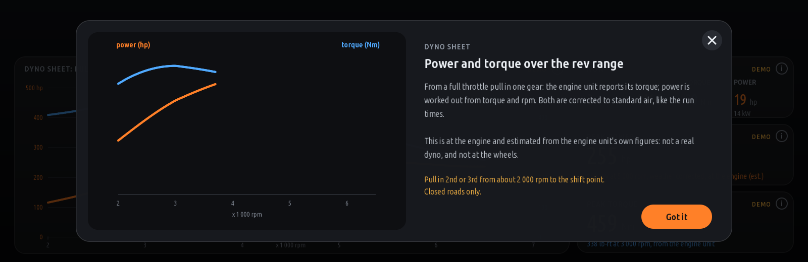 |
| Info popup: the wastegate, gas through the turbine or past it |  |
| How to use | 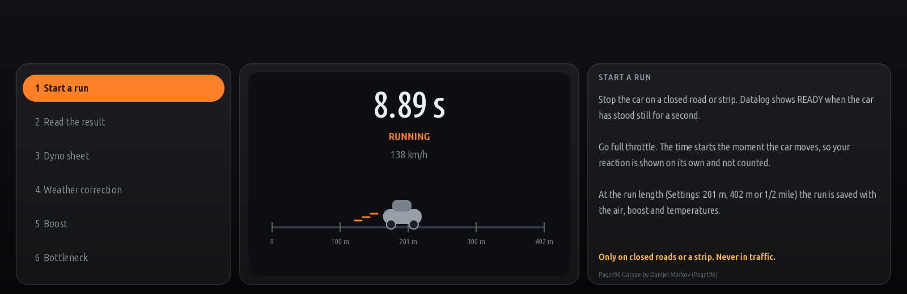 |
| Settings |  |

The screenshots and GIFs come from the upstream emulator (the car's own draw engine) on demo data.

**What it reads from the car.** Only reads, never writes. From the car's own broadcasts: speed, engine speed, engine
torque, the gear, oil and coolant temperature, the gearbox oil temperature, the outside temperature (mirror sensor) and
the tyre pressures and temperatures (TPMS). From the engine unit, with read requests only (UDS 22, through the kit's
read only diagnostic link) and only while Datalog's screen is shown: the intake air after the filter, the charge air
before the throttle, the intake manifold pressure, the outside air pressure, the boost target, the engine's own torque
figure, the accelerator pedal, the exhaust gas temperature model and, on engines with an electric wastegate, its
position and the duty cycle at its actuator. When Datalog is not on the screen nothing goes on
the bus; runs are still timed from the broadcasts.

**How it works out the numbers.**

- Times start when the car moves (0.5 km/h), so the reaction (throttle to moving) is shown on its own. Crossing
  moments are worked out between speed samples, so they do not depend on how often the car sends speed.
- Weather correction: SAE J1349 from the intake air temperature and the outside pressure at the launch, as dry air.
  Distances are corrected by the cube root of the factor, speed windows by the factor, the trap speed the other way.
  The raw time is always shown next to the corrected one.
- Boost = intake manifold pressure minus the outside pressure, so it is below zero (vacuum) at idle.
- Wastegate: its position, 0 % shut to 100 % open, on the Boost page and as its own line on the right axis of the
  pressure chart. The card says in words when it opened and closed in the last run (shut while the boost builds,
  the boost at which it opened to hold the target, how it sits at idle), and warns when the boost went 0.15 bar or
  more past the target or stayed that much short of it (a wastegate stuck or slow shut, or open). Shown only when
  the engine reports it.
- Dyno: a pull is full throttle in one gear (2nd or higher) with the rpm climbing over at least 1 500 rpm. Torque is
  the engine unit's own figure; power = torque x rpm / 7 121 (hp). Both corrected to standard air.

**Limits.**

- The dyno sheet is an estimate at the engine from the engine unit's own torque figure: not a real dyno, and not at
  the wheels (where 10 to 15 % less arrives).
- The car reports no humidity, so the correction treats the air as dry. A turbo engine makes up some of the thin air
  itself, so the correction overstates its loss up high.
- The engine unit values are read only while the screen is shown, so a run timed with Datalog in the background has
  no boost or air trace.
- The exhaust gas temperature is the engine unit's model, not a sensor, and not every engine has it.
- The wastegate position is the engine unit's own reading of its electric actuator; engines with a vacuum wastegate
  do not report one, and the engine unit gives no wastegate target to compare with.
- The identifiers are BMW's DME8FF_R ones (B38, B48, B58, the V8s' engine units in the same family); a diesel's
  engine unit answers some of them. Not tried on a car yet: tested with demo data in the PC preview and the emulator.
  ID7 head units only (iDrive 8 is not tried yet).

**Works with.** Every BMW with the MGU Store on an iDrive 7 head unit, whatever its engine. Four and six cylinders
with one turbo: boost, the electric wastegate, the dyno. Two turbos (S58): both drawn in the air path and the
wastegate picture. A V8 with two engine units (N63, S63, S68): boost and wastegate of bank 1 and bank 2 side by side,
bank 2 from its own engine unit. Diesels (B47, B57): boost and the dyno, no wastegate card (their turbo has variable
vanes). A plug-in hybrid: the engine values while the engine runs. An electric car: the speed ring, runs, tyres and
temperatures; no Boost or Dyno page. The engine is found from the car's own answers, never assumed; Settings,
Demo car shows each layout.

| Car | Screenshot |
|---|---|
| V8, two engine units: boost of both banks, both wastegates |  |
| S58, two turbos: the wastegate explained for both |  |
| Electric: the speed ring in place of the boost | 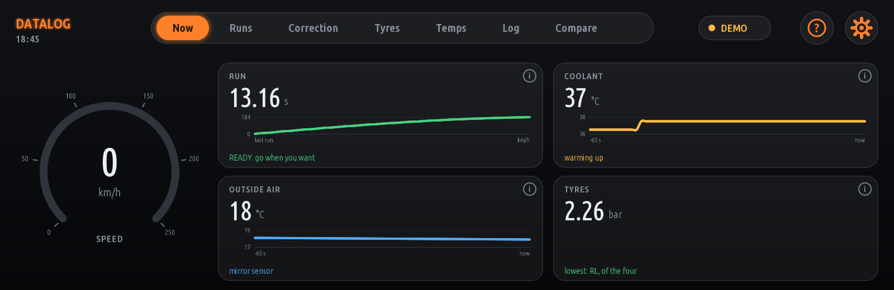 |

**Settings.** The Display block (the same in every Paget96 Garage app): Renderer, Frame rate (60 fps by default), Full screen (on by default),
Follow ambient lighting, Demo data (Off or On, Off by default; while it is on the header says DEMO, tap it to turn it off), Time zone (Auto, or a zone from the list), and while the demo runs Demo car (B48, B58, S58, S63 V8, B57 diesel, PHEV or EV). Then Datalog's own: Run length (201 m, 402 m or 1/2 mile), Boost target (the
mark on the boost ring, 1.45 bar by default), Tyre target (hot, 2.40 bar by default, the Tyres page compares with it)
and Units (metric or imperial).

<a id="p96_health"></a>
### Health

One look at the whole car: what the control units have stored, how the 12 V battery really is, what service
is due, whether a tyre is losing air, the fluids, and one score from 0 to 100 that sums it up. Every fault scan
is kept, so you see when a fault came and went. Save a report before you clear faults, and show the whole thing
to your mechanic as a QR code that any phone camera reads.

Health shows only what your car reports: a page, card, chart line, setting or button appears once your car
answers it (found the first time, remembered for that car). A car without tyre pressure sensors has no Tyres page,
and only the service items the car itself can reset get a Reset. The screenshots use demo data (Demo data On, so the header shows the amber DEMO pill and every card says DEMO), which shows everything.


| Page | Screenshot |
|---|---|
| Overview: the score and six checks |  |
| Faults by unit: fault memory |  |
| Faults: info memory |  |
| Faults: permanent emission faults |  |
| Faults: one unit |  |
| Faults: details and freeze frame |  |
| Faults: history (every scan kept) |  |
| Faults: readiness (engine light and emission monitors) | 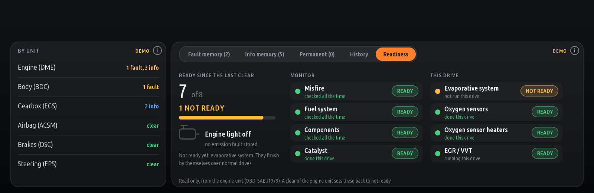 |
| Clear faults: the confirmation (the engine unit not ticked) | 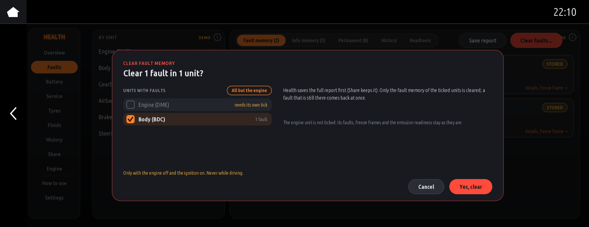 |
| Clear faults: the engine unit ticked, with its warning |  |
| Clear faults: what came back |  |
| Battery: resting voltage, start dip, charge, 14 nights | 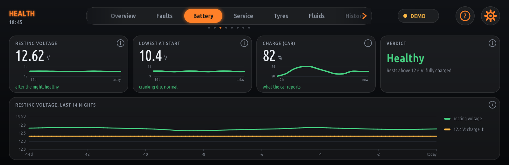 |
| Service: the car's items, our intervals, your parts |  |
| Service: add a part |  |
| Service: reset one of the car's items |  |
| Tyres: pressures and the 4 week trend |  |
| Fluids: levels and warm-up |  |
| Engine: a bar per cylinder (misfires, rough running, ignition), knock, camshafts, lambda, rail |  |
| History: score over 12 weeks, what changed | 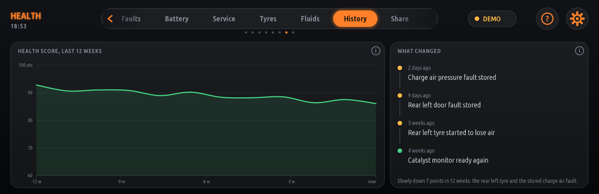 |
| Share: the report as a QR code |  |
| A reminder when something is due |  |
| Info popup (every card has an (i)) | 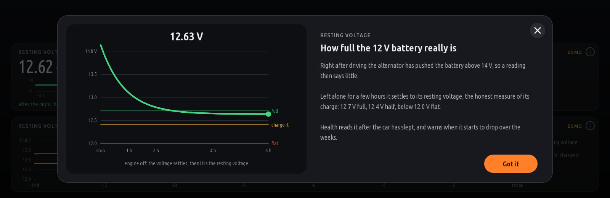 |
| How to use |  |
| Settings |  |

Every card's info popup is in [docs/media/p96_health/popups/](docs/media/p96_health/popups/).

**What it reads from the car.** From the car's own broadcasts: engine speed, oil and coolant temperature, the
12 V charge the battery sensor reports, the speed (Health counts the km it sees), the tyre pressures, the
service list the cluster shows, and the Check Control messages. Over the head unit's diagnostic link, only while
Health's screen is shown: the fault memory and info memory of every unit, the engine's permanent emission faults,
a fault's freeze frame when you open it, and from the engine unit the 12 V voltage, the oil level and the km on the
oil and spark plugs. While the Faults page is shown, the engine unit's OBD readiness (service 01, PID 01 and, when the
car answers it, PID 41 for this drive): the engine light and each emission monitor the car has, ready or not. Nothing is read in the background over the diagnostic link.

**What it writes, and only these two.** Both only when you tap and confirm, with the engine off and the ignition on,
never by themselves:

- **Clear faults** empties the fault memory of the units you tick (UDS 14 FF FF FF to each of them, never to all
  units at once), the way a workshop tester does. Every unit with a fault is ticked for you except the engine unit
  (DME): it needs its own tick, also with "All but the engine". Clearing it also sets the OBD readiness monitors
  (catalyst, oxygen sensors, misfire, fuel system and the others) back to not ready and erases its freeze frames;
  they come back only after a drive cycle, so an emissions test can fail until then. The dialog says so as soon as
  the engine unit is ticked. The learned adaptations (fuel trims, throttle, knock) are a separate function and
  should not be cleared by this (not yet checked on a car). Health saves the full report first. Info memory and
  permanent emission faults stay. Afterwards it scans again and shows which faults came back at once: their cause
  is still there; after an engine unit clear it says the readiness was reset and opens Faults, Readiness on a tap.
  History notes the clear and each monitor that is ready again.
- **Reset a service item** (oil, front or rear brakes, brake fluid, vehicle check) in the instrument cluster, the
  workshop's own CBS reset, and only when the cluster itself says the item may be reset now. Afterwards the item is
  read again.

**Limits.**

- The 12 V resting voltage has no broadcast signal, so Health reads it the first time you open it after the car
  slept for 3 hours or more, with the engine off. A night you do not open Health has no reading.
- The dip at start is measured only when you start the engine with Health open.
- Fault texts: the car keeps none and BMW's text tables are not ours to share, so a fault Health has no words for
  shows its code and unit: look it up by both.
- Coolant and washer fluid have only a low warning in the car, no level.
- Readiness is read only, and never lowers the score: not ready after a clear is normal. It is read only while the
  Faults page is shown, so History notes a monitor ready again when Health next sees it, not the moment it finished.
- Air filter, gearbox oil and coolant are counted from when you mark them done on the Service page.
- Health cannot put up a notification on the screen: reminders show on its home-screen widget and once when you
  open the app.
- Tested on the PC preview with demo data only. ID7 head units only for now.

**Works with.** Every BMW with the MGU Store on an iDrive 7 head unit. The Engine page has one bar for each of the car's
cylinders, as many as its engine unit lists (3, 4, 6 or 8); a V8's two banks side by side, bank 2's ignition from its
second engine unit. Petrol: misfires, rough running, ignition angle, knock control, the camshafts, lambda and the rail
pressure. Diesel: rough running and the rail pressure on its own scale (up to about 2 700 bar), glow plugs, fuel
filter and AdBlue among the service parts, no spark plug interval, the diesel readiness monitors. Electric: no
Engine page and no engine items in Service. Settings, Demo car shows each layout.

| Car | Screenshot |
|---|---|
| V8: misfires per cylinder, bank 1 and bank 2 | 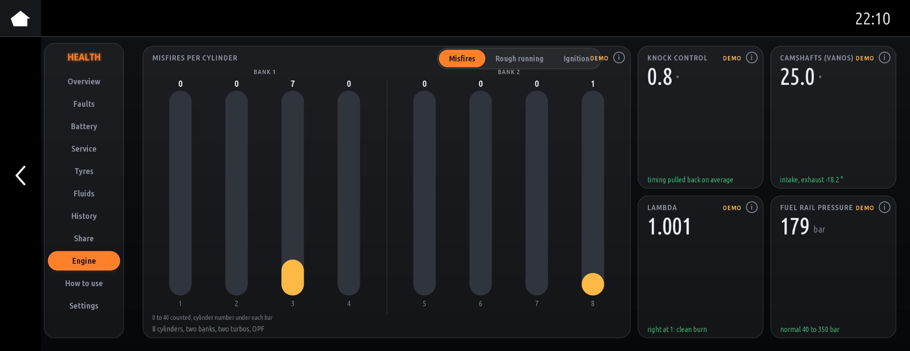 |
| Six cylinders: rough running |  |
| Diesel: rough running and the rail pressure |  |

**Settings.** The Display block (the same in every Paget96 Garage app): Renderer, Frame rate (60 fps by default), Full screen (on by default),
Follow ambient lighting, Demo data (Off or On, Off by default; while it is on the header says DEMO, tap it to turn it off), Time zone (Auto, or a zone from the list), and while the demo runs Demo car (B48, B58, S58, S63 V8, B57 diesel, PHEV or EV). Then Health's own: Nightly battery check (on or off), Battery warning at (the
resting voltage that counts as low, 12.4 V by default), Tyre warning at (how much lower than the other three a tyre
may be, 0.1 bar), Units, Our intervals (strict or as the car), and the interval of each of our items (engine oil,
spark plugs, air filter, gearbox oil, coolant), which you can also change by tapping the item on the Service page.

<a id="p96_standby"></a>
### Standby

A calm screen for waiting in the car and for night drives: a big clock whose digits never move, the
date, the outside temperature with an ice warning, the 12 V battery and the range. After a few
seconds the menu fades out and only the clock stays; a tap brings it back. At night the clock dims to
a warm dark colour. Standby only reads.


| Page | Screenshot |
|---|---|
| Clock |  |
| Clock, the menu faded out | 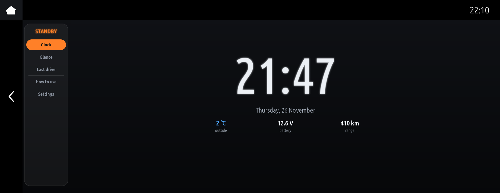 |
| Clock at night | 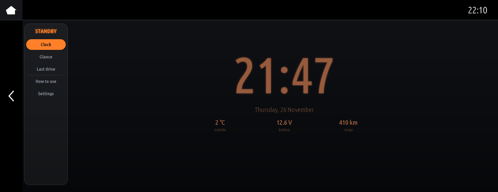 |
| Glance |  |
| Last drive | 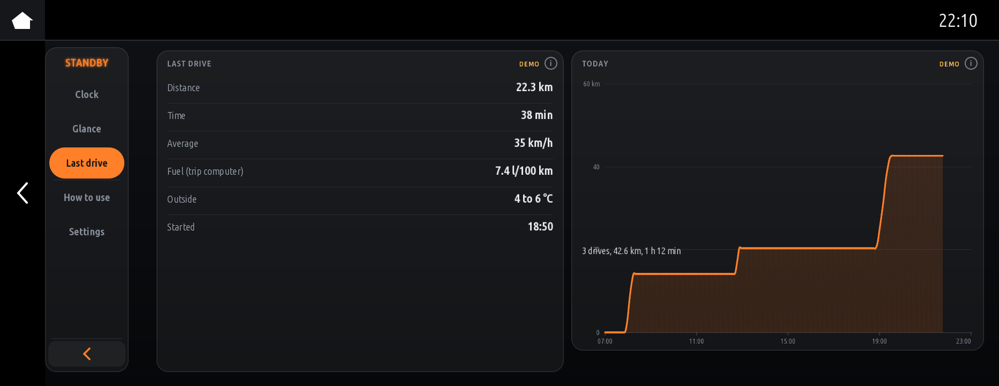 |
| Card info | 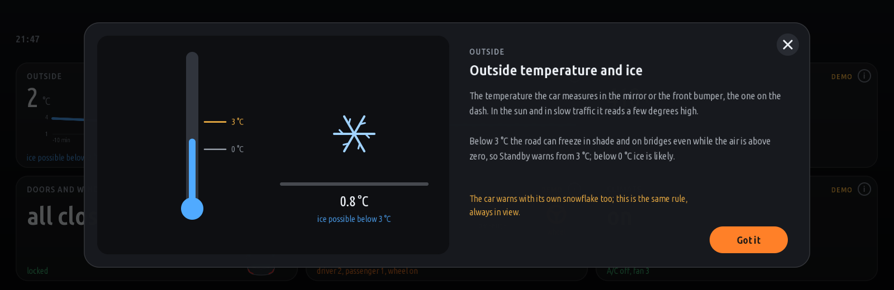 |
| How to use | 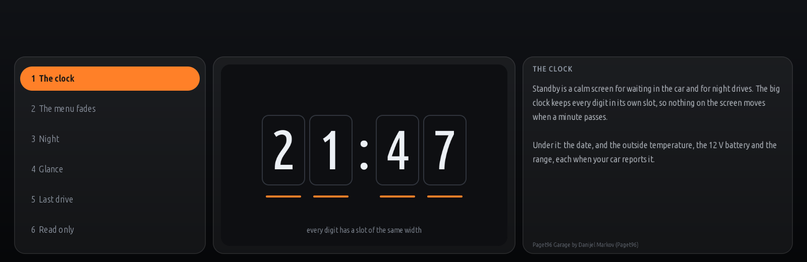 |
| Settings |  |

#### Pages

- **Clock:** every digit in a slot as wide as the widest digit, so nothing shifts when a minute
  passes. Under it the date, outside (blue when ice is possible), the 12 V battery and the range.
- **Glance:** outside with the ice warning (possible below 3 °C, likely below 0 °C), the 12 V battery,
  range and fuel, doors (windows and the lock where the car sends them), seat heating (a level per seat) and
  the steering wheel (a small wheel, orange while its heating is on), the climate.
- **Last drive:** this drive or the last one (distance, time, average, fuel, outside) and every drive
  of today on one line.

#### What it reads from the car

Broadcast signals only (outside, 12 V charge, range and fuel, the trip computer's average, speed, day
or night, door switches, seat and wheel heating, climate, A/C, blower, locked and left), plus one
read: the 12 V voltage from the engine unit's battery sensor (22 5853) through the kit's read-only
link, every 10 seconds and only while Clock or Glance is shown. A card appears only once your car
has sent its value. Details: [apps/p96_standby/README.md](apps/p96_standby/README.md).

#### Limits

- Windows and the central lock are found by field names that are not confirmed yet; without them the
  card shows the doors only.
- A drive's distance comes from the speed signal, not the odometer. Fuel is the trip computer's
  average, in l/100 km only.

#### Works with

Every BMW with the MGU Store on an iDrive 7 head unit, petrol, diesel, hybrid or electric: Standby shows what the car
broadcasts. On an electric car the range card has no fuel line. Settings, Demo car shows each.

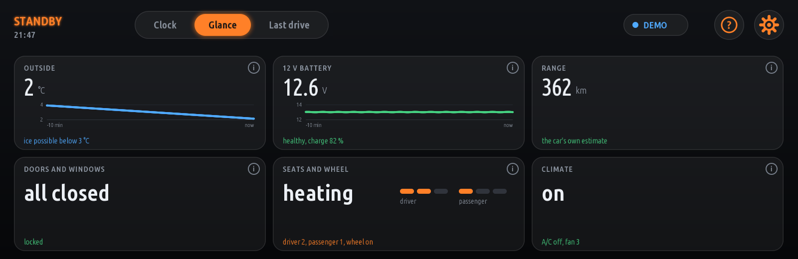

#### Settings

The Display block (the same in every Paget96 Garage app), then Clock (24 h or 12 h), Night dimming
(Auto, On, Off; Auto follows the car's day and night, else 20:00 to 07:00) and Hide the menu after
(5, 10 or 30 seconds, or Never).

<a id="p96_exhaust"></a>
### Exhaust

The exhaust from the engine to the tail pipe. Exhaust shows the gas on its way with the temperatures the engine
unit reports, runs the exhaust flap with your own rules, watches the particulate filter (OPF) and its
regenerations, tells you when your drives are too short for the filter, times the catalyst warm-up after a cold
start, draws how the sound is made and what damps it, and lists what gives a better sound without changing
anything on the car. A Setup page records what your exhaust has, and the drawings follow it.

Exhaust shows only what your car reports: the Flap pages appear when the engine unit answers for an electric
flap, the filter pages when it reports soot or load, and a rule can only use a value your car sends. The
screenshots use demo data (Demo data On, so the header shows the amber DEMO pill and every card says DEMO), which shows everything.


| Page | Screenshot |
|---|---|
| Now: engine to tail pipe, live |  |
| Flap: AUTO, OPEN, CLOSE, CAR and the rules |  |
| Flap: a car with two flaps |  |
| Flap: add a rule | 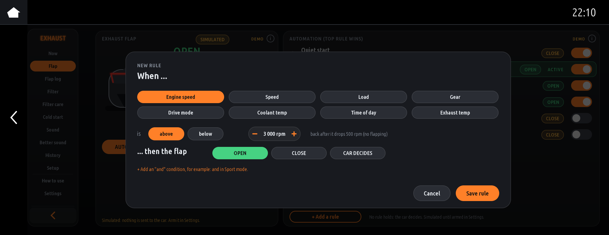 |
| Flap: change a rule, with an "and" | 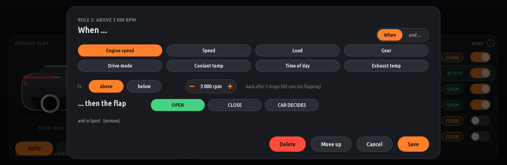 |
| Flap log: the week and every change | 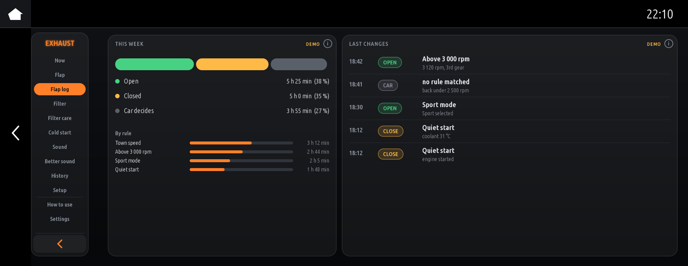 |
| OPF: load, regeneration, the last five |  |
| OPF: regenerating now |  |
| Filter care: short drives, ash |  |
| Cold start: the catalyst warm-up |  |
| Sound: what each part damps |  |
| Better sound: tips checked live | 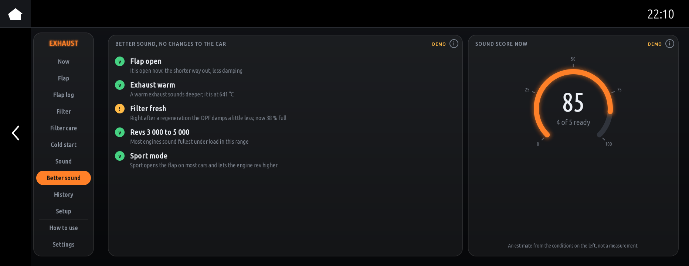 |
| History: 8 weeks of the filter |  |
| Setup: what your exhaust has |  |
| Arming the flap control |  |
| Info popup (every card has an (i)) |  |
| How to use |  |
| Settings |  |

Every card's info popup is in [docs/media/p96_exhaust/popups/](docs/media/p96_exhaust/popups/).

**The flap and its rules.** AUTO lets your rules decide: an ordered list, the top rule that is switched on and
holds wins, and when none holds the car decides. A rule is "when engine speed, speed, load, gear, drive mode,
coolant temperature, time of day or exhaust temperature is above or below a value (and optionally a second
condition), then the flap OPEN, CLOSE or CAR DECIDES". Every number has a margin ("above 3 000 rpm" opens above
3 000 and closes only below 2 500), so the flap does not click at the edge. OPEN and CLOSE hold the flap; CAR
hands it back. With two flaps (a V8 with two engine units) each can be set on its own.

**What it writes, and only this.** The exhaust flap, through BMW's own flap control on the engine unit (2F 60 FD: open at 10 %, close at 90 %, hand back), sent again every
15 s because the engine unit lets a tester's command go after about 20 s. Out of the box it is **simulated**:
nothing is sent until you arm it in Settings and confirm. Opening the app sends nothing by itself; a command
leaves only on a button press, a change of what your rules decide, or the car coming up with OPEN, CLOSE or AUTO
kept. What was asked, whether the engine unit took it and what was read back are shown apart, and a request is
never shown as done without the read-back. CLOSE is handed back to the car above an engine speed you set
(4 000 rpm by default) and when there is no engine speed. Disarming hands every flap back first.

**What it reads from the car.** From the car's broadcasts: engine speed, speed (Exhaust counts the km it sees),
gear, drive mode, coolant and outside temperature. From the engine unit, only while Exhaust's screen is shown:
soot, ash and the load of the particulate filter, its temperature, the exhaust temperature after the catalyst (the
engine unit's model), the exhaust camshaft and the engine load; and the flap's state.

**Limits.**

- A regeneration is seen from the outside (the filter hot and the soot falling): the car reports no regeneration
  status Exhaust could find. Only regenerations while the app is open are seen.
- The regeneration mark (about 80 %), the point where a filter counts as full of ash (45 g) and the catalyst's
  working temperature (300 °C) are estimates; the car does not report them.
- The km are the ones Exhaust counted from the speed, not the odometer.
- Rules on load and exhaust temperature work only while the app is open; the others work in the background too.
- The sound percentages illustrate each part; they are not a measurement. The app records your setup and never
  advises removing a catalyst or a filter.
- Which engine unit drives the left flap on a car with two is not known yet: there is a setting for it.
- Tested on the PC preview with demo data and a pretend engine unit only. ID7 head units only for now.

**Works with.** Every BMW with an engine where the MGU Store runs on iDrive 7. The drawing shows the car's own
cylinders, one or two turbos and one or two pipes. One flap (60 FD) or a V8's two flaps, each on its own engine unit
(61 1E, as upstream does). Petrol cars: the OPF page. Diesels: the DPF page and words, the SCR catalyst in the drawing
and the AdBlue tank when the engine unit reports it. A plug-in hybrid: the values while the engine runs. An electric
car has no exhaust: the app says so on its one page and reads nothing. Settings, Demo car shows each layout.

| Car | Screenshot |
|---|---|
| V8: two banks, two turbos, two pipes, two flaps |  |
| Diesel: DPF, SCR and the AdBlue tank | 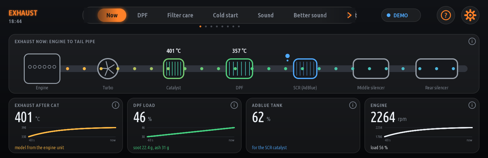 |
| Electric: no exhaust |  |

**Settings.** The Display block (the same in every Paget96 Garage app): Renderer, Frame rate (60 fps by default), Full screen (on by default),
Follow ambient lighting, Demo data (Off or On, Off by default; while it is on the header says DEMO, tap it to turn it off), Time zone (Auto, or a zone from the list), and while the demo runs Demo car (B48, B58, S58, S63 V8, B57 diesel, PHEV or EV). Then Exhaust's own: Flap control (Simulated or Armed, with a confirmation),
Hold OPEN and CLOSE (sent again every 15 s), Close: hand back above (3 000, 4 000, 5 000 rpm or never), and on a
car with two flaps, Left flap is (bank 1 or 2).


### Lights

The car's own lights: any colour on the ambient light, and light shows over the outside lamps
(ready made and your own, beat by beat), only while the car stands still. Simulated until you arm it in
Settings; the car takes its lights back by itself when the app stops. Not tried on a car as Lights
yet.


| Page | Screenshot |
|---|---|
| Ambient | 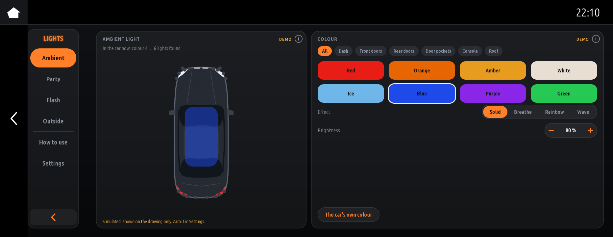 |
| Shows |  |
| Edit a show | 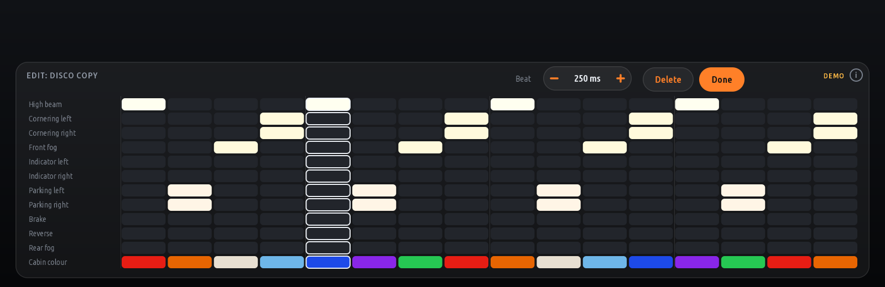 |
## How every app works

Every Paget96 Garage app follows the same rules, so once you know one, you know them all.

- **One look.** Dark glass cards, the app name and a small clock top left, page tabs on top that
  scroll when there are many, How to use (?) and Settings (gear) top right.
- **One app per topic.** No thirty small apps: each app holds everything about its topic.
- **Every card explains itself.** Tap a card with an (i) for what it shows, where the value comes from
  and what is normal, with a picture or an animation.
- **Every chart has its values.** Axes with numbers and units; rings show their scale.
- **Smooth.** Everything moves at 60 fps: values glide, nothing jumps. Frame rate and renderer can be
  changed in Settings (60 fps is the default).
- **Only what your car has.** A card, page or button appears only when your car reports that value or
  has that function.
- **Every engine.** Three to eight cylinders, one or two turbos, a V8 with two engine units, diesels, plug-in
  hybrids and electric cars: each app finds the engine from the car's own answers (cylinder count, engine units,
  fuel) and lays its pages out for it, never for one car. Each app's "Works with" says what differs.
- **Real data unless you choose demo.** Demo data in Settings is Off or On, and Off by default: the app shows
  only what your car sends, or WAIT and empty cards until it answers. Nothing turns the demo on by itself. While
  it is on, an amber DEMO pill sits where LIVE does and every card says DEMO; tap the pill (or press the knob on
  it) and the car's own values are back at once. Demo car picks which engine the samples show.
- **Colours mean something.** Green is fine, amber look at it soon, red now. The accent follows your
  front ambient light, but data colours never change.
- **Read first.** The apps read what the car already reports. The only things they ever change, and
  only when you tap and confirm: clearing the fault memory and resetting a service item (Health),
  and the exhaust flap (Exhaust).
- **Full screen or not.** Settings, Full screen: on (the default) the app covers the screen with its own header;
  off it sits in the car's own frame, under the car's title and clock, with the car's buttons. Full screen needs
  the GPU renderer, so it is not offered with Software.
- **Send a report.** Every app has it at the top of its Settings page: see [Send a report](#send-a-report).
- **Your popups stay on top.** An app must never cover the car's own popups (work in progress).

## Send a report

Something wrong, or a value your car has that an app does not show? Every app can send a report to this
repository's [issues](https://github.com/Paget96/Paget96-Garage/issues), from Settings, **Send a report**.
Reports from real cars are what speed up development the most: each one tells us at once what car and setup it is.

**How it works.** The car needs no internet and no account. The app shows a QR code with a GitHub "new issue" link
whose title and text are already filled in. You scan it with your phone camera, sign in to GitHub on the phone if
it asks (a free account: an email, a password and a user name at [github.com/signup](https://github.com/signup)),
check the text, write what happened, and press Submit. The report goes from your own GitHub account; nothing is
sent until you press Submit, and nothing at all is sent from the car.

**First you see exactly what goes in,** line by line, before the code is made:

| Line | What it is |
|---|---|
| App | the app's name and version |
| iDrive, firmware | iDrive 7 or 8 from the screen the renderer reports, and the head unit's firmware train (e.g. P18_23w44.2-1-3) |
| Engine | what the app found on your car (fuel, cylinders, engine units, turbos, filter), or "not found yet" |
| Settings | only the settings you changed from their defaults |
| Log | how many warnings and errors the app recorded, and the newest few, short (time and the first line) |
| VIN | only if you tick "Add the VIN" (Health, which reads it from the car) |

**Never sent:** your location, anything about your phone or contacts, names, the full log, or the VIN unless you
tick it (a VIN in a log line is replaced by `<VIN>`).

**Size.** The code stays at QR version 15 or smaller (77 x 77 modules), which a phone camera reads easily from the
car's screen. When the log does not fit, the oldest log lines are left out and the text says it was shortened; the
car facts are never cut. The code is made on the head unit by our own encoder (`lib/qr.js`), checked module by
module against another encoder and read back with a QR decoder in the tests.

| Settings, Send a report | What will be sent | The code |
|---|---|---|
| 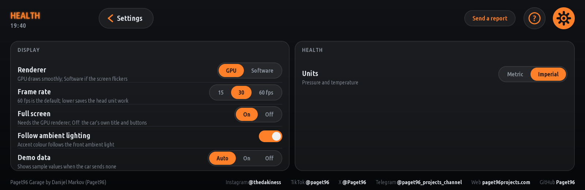 | 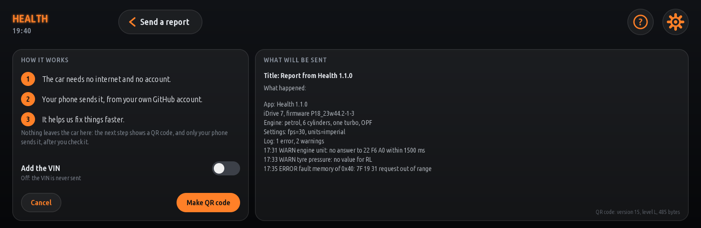 | 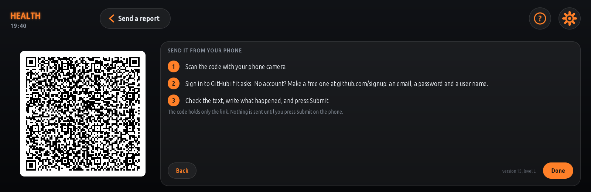 |

You can also open an issue by hand with the [report template](.github/ISSUE_TEMPLATE/report.md).

## Our renderer

An iDrive 7 app does not draw pixels itself: it sends a list of shapes and text over a socket, and a renderer
draws them on the head unit's GPU. Paget96 Garage has its own renderer, **p96-renderd**, in
[renderer/](renderer/README.md). It starts from mgu-render (Robert Nisipeanu and IterioDev, GPL-3.0-or-later) and speaks the same protocol, so any app written for that renderer
runs on ours unchanged.

**Status: it builds and its tests pass on a PC. It has not run on a car yet, and no app uses it yet.**

What it does differently, each point checked on a PC (the full list, with how each was checked, is in
[renderer/COMPARISON.md](renderer/COMPARISON.md)):

- **Its own place.** Its own socket, compositor ids and touch divert. It never takes the shared socket of the other
  renderers, so it runs beside the MGU Store's renderer and the kit's without taking their apps.
- **Car popups on top.** When the car shows something that takes the input over an app (a check control message,
  the menu, the voice assistant), the app's picture steps back and touch and the controller go to the car. The
  popup watch also notices other popups that come up over the app area and can make the picture step back for
  them.
- **Fixes for what people reported** about mgu-store's renderer that are still open there: after an iDrive start,
  a screen the car was still starting is watched again, so an app does not get stuck inside the car's page with
  the car's button bar (their pull request #156).
- **Fixes from their history** that the renderer we started from did not have yet: a slow firewall tool no longer
  stops the drawing or gets the renderer restarted, and the touch rule comes out even when `/tmp` is full.

Not measured yet: CPU, memory and frame time on the head unit. Nothing here says it is faster.

## Building

You need Python 3 and Node.js (the head unit runs Node 8.16.2 and Python 3.12; code stays Node 8
compatible). BMW's oap-sdk is not in this repository and never will be: the MGU Store takes it
from the head unit. For a local build, put your own copy in `oap-sdk/` (ignored by git).

```
python tools/build.py <app id>      # dist/<id>@<version>.tgz
python tools/check_docs.py          # every app documented, icons in spec, no em dashes
node tools/ui_demo.js               # the Paget96 Garage UI reference page, docs/design/ui-demo.png
python tools/make_icon.py clock apps/<id>/icon.png
node tests/p96_datalog.test.js      # an app's tests (tests/<id>.test.js), plain Node
node tools/datalog_preview.js       # Datalog drawn on demo data, software path, PNGs in .stage/
```

How the pieces fit:

- `kit/` is our app kit: runtime, GPU renderer client, build tools ([Credits](#credits)).
- `tools/build.py` stages the apps with the kit and runs the kit's build.
- `lib/ui.js` is the Paget96 Garage look on top of the kit ([docs/DESIGN.md](docs/DESIGN.md)).
- `mgu-repo.json` tells the MGU Store how to build each app.
- Icons follow one template ([docs/ICONS.md](docs/ICONS.md)).

## Contributing

Issues and pull requests are welcome here, for the apps and for the kit alike. App ids start with
`p96_`. Text never uses an em dash or an en dash.

## Follow

New apps, videos from the car and early builds show up here first:

| | |
|---|---|
| Instagram | [@thedakiness](https://www.instagram.com/thedakiness/) |
| TikTok | [@paget96](https://www.tiktok.com/@paget96) |
| X | [@Paget96](https://x.com/Paget96) |
| Telegram channel | [paget96_projects_channel](https://t.me/paget96_projects_channel) |
| Telegram group, for questions | [Paget96_Projects](https://t.me/Paget96_Projects) |
| Web | [paget96projects.com](https://paget96projects.com) |
| GitHub | [Paget96](https://github.com/Paget96) |

The same names are at the bottom of every app's Settings page.

## Credits

- The app kit in `kit/` started from
  [idrive7-apps](https://github.com/cauliflowermossgrape/idrive7-apps) by cauliflowermossgrape and
  contributors (MIT licensed, see [NOTICE](NOTICE)) and is developed further here.
- Installation and updates: [MGU Store](https://github.com/robertnisipeanu/mgu-store) by
  robertnisipeanu.

## Disclaimer

These apps run on a rooted head unit. Rooting and installing third-party software is at your own
risk and may affect your warranty. The apps only read data the car already reports, except where
an app's own section names a write. Do not use them in a way that distracts you while driving.
Paget96 Garage is not affiliated with, endorsed by or connected to BMW AG. BMW and iDrive are
trademarks of BMW AG.

## License

Copyright (c) 2026 Danijel Markov (Paget96).

The code is free software under the [GNU GPL v3](LICENSE) (GPL-3.0-only) with additional terms in
[NOTICE](NOTICE): every copy or changed version must keep our credit and show it in the app,

> Based on Paget96 Garage by Danijel Markov (Paget96) - github.com/Paget96/Paget96-Garage

a changed version must be marked as changed and use its own name and icons, and the names and brand
are not licensed ([TRADEMARKS.md](TRADEMARKS.md)). The parts of `kit/` taken from idrive7-apps keep
their MIT license ([kit/LICENSE](kit/LICENSE)).
