# Paget96 Garage


Paget96 Garage is a set of apps for the BMW iDrive 7 head unit (MGU), made by Paget96. They run on
a rooted head unit next to BMW's own apps, read what the car already reports, and show it in one
modern look: dark glass cards, orange accents, live numbers. Every app in this repository is
installed and updated from the MGU Store.

> **Status, November 2026:** **Health** is built; testing on a car is next. **Datalog** is built as well.
> **Exhaust** and **Standby** are designed (previews below). Nothing has been tested on a car yet, so
> treat everything here as a preview until the first release.

## Contents

- [Install](#install)
- [The apps](#the-apps)
- [Coming next](#coming-next)
- [How every app works](#how-every-app-works)
- [Building](#building)
- [Contributing](#contributing)
- [Credits](#credits)
- [Disclaimer](#disclaimer)
- [License](#license)

## Install

### From the MGU Store (recommended)

The Store builds each app on the head unit straight from this repository.

1. Open the MGU Store on the head unit.
2. Settings, **Add source**, then type `Paget96/Paget96-Garage`.
3. Pick an app from the list and install it.

Updates arrive in the Store like any other source's. Paget96 Garage apps draw through the GPU renderer from
[idrive7-apps](https://github.com/cauliflowermossgrape/idrive7-apps) (a default Store source); the
Store installs it with the first app that needs it.

### Manual

For development only: build a package on a PC (see [Building](#building)) and install the
`dist/<id>@<version>.tgz` with the MGU Store's stick or deploy tool, as its
[publishing guide](https://github.com/robertnisipeanu/mgu-store/blob/main/docs/PUBLISHING.md)
describes.

## The apps

| | App | What it does |
|---|---|---|
|  | [Health](#p96_health) | One look at the whole car: faults with their history, 12 V battery, service, tyres, fluids, a score and a report to share |
|  | [Datalog](#p96_datalog) | Times every pull and logs boost, temperatures, air and tyres with it |

<!--
One row per app, in this form:
| /icon.png" width="48"> | [<Name>](#<id>) | one line |

Then one section per app, in this form (and the same text in apps/<id>/README.md):

<a id="<id>"></a>
### <Name>

What it is for, in two or three sentences.


| Page | Screenshot |
|---|---|
| <page> |  |

**What it reads from the car:** the signals, in plain words.
**Limits:** what it cannot do.
**Settings:** each setting and what it changes.

tools/check_docs.py fails the build when an app has no section, no GIF or no screenshot.
-->

<a id="p96_health"></a>
### Health

One look at the whole car: what the control units have stored, how the 12 V battery really is, what service
is due, whether a tyre is losing air, the fluids, and one score from 0 to 100 that sums it up. Every fault scan
is kept, so you see when a fault came and went. Save a report before you clear faults, and show the whole thing
to your mechanic as a QR code that any phone camera reads.

Health shows only what your car reports: a page, card, chart line, setting or button appears once your car
answers it (found the first time, remembered for that car). A car without tyre pressure sensors has no Tyres page,
and only the service items the car itself can reset get a Reset. The screenshots use demo data, which shows everything.


| Page | Screenshot |
|---|---|
| Overview: the score and six checks |  |
| Faults by unit: fault memory |  |
| Faults: info memory | 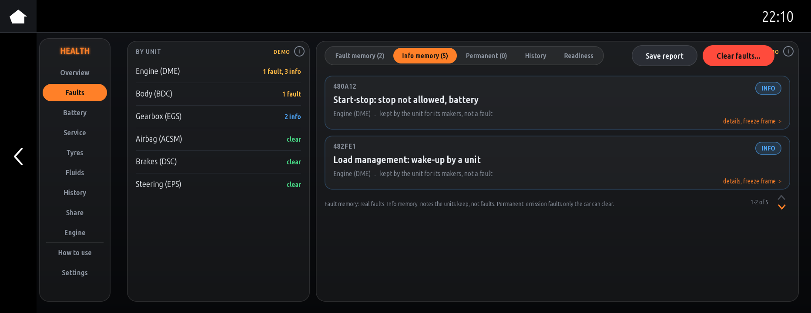 |
| Faults: permanent emission faults | 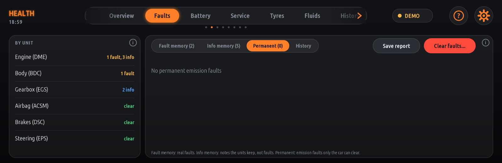 |
| Faults: one unit |  |
| Faults: details and freeze frame |  |
| Faults: history (every scan kept) |  |
| Clear faults: the confirmation |  |
| Clear faults: what came back | 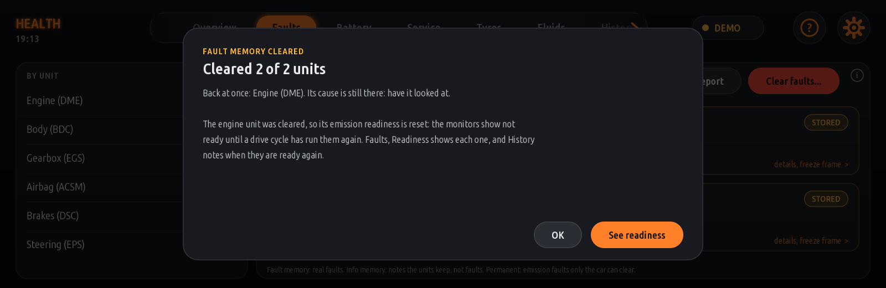 |
| Battery: resting voltage, start dip, charge, 14 nights |  |
| Service: the car's items, our intervals, your parts |  |
| Service: add a part | 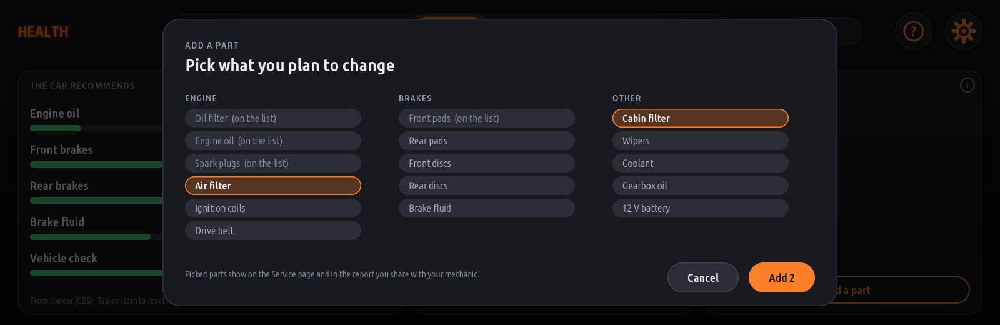 |
| Service: reset one of the car's items |  |
| Tyres: pressures and the 4 week trend |  |
| Fluids: levels and warm-up | 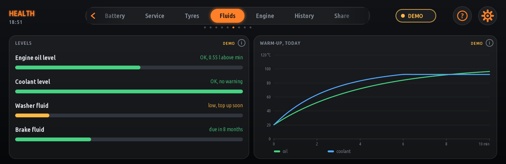 |
| History: score over 12 weeks, what changed |  |
| Share: the report as a QR code |  |
| A reminder when something is due |  |
| Info popup (every card has an (i)) |  |
| How to use |  |
| Settings |  |

Every card's info popup is in [docs/media/p96_health/popups/](docs/media/p96_health/popups/).

**What it reads from the car.** From the car's own broadcasts: engine speed, oil and coolant temperature, the
12 V charge the battery sensor reports, the speed (Health counts the km it sees), the tyre pressures, the
service list the cluster shows, and the Check Control messages. Over the head unit's diagnostic link, only while
Health's screen is shown: the fault memory and info memory of every unit, the engine's permanent emission faults,
a fault's freeze frame when you open it, and from the engine unit the 12 V voltage, the oil level and the km on the
oil and spark plugs. Nothing is read in the background over the diagnostic link.

**What it writes, and only these two.** Both only when you tap and confirm, with the engine off and the ignition on,
never by themselves:

- **Clear faults** empties the fault memory of the units that hold a fault (UDS 14 FF FF FF), the way a workshop
  tester does. Health saves the full report first. Info memory and permanent emission faults stay. Afterwards it
  scans again and shows which faults came back at once: their cause is still there.
- **Reset a service item** (oil, front or rear brakes, brake fluid, vehicle check) in the instrument cluster, the
  workshop's own CBS reset, and only when the cluster itself says the item may be reset now. Afterwards the item is
  read again.

**Limits.**

- The 12 V resting voltage has no broadcast signal, so Health reads it the first time you open it after the car
  slept for 3 hours or more, with the engine off. A night you do not open Health has no reading.
- The dip at start is measured only when you start the engine with Health open.
- Fault texts: the car keeps none and BMW's text tables are not ours to share, so a fault Health has no words for
  shows its code and unit: look it up by both.
- Coolant and washer fluid have only a low warning in the car, no level.
- Air filter, gearbox oil and coolant are counted from when you mark them done on the Service page.
- Health cannot put up a notification on the screen: reminders show on its home-screen widget and once when you
  open the app.
- Tested on the PC preview with demo data only. ID7 head units only for now.

**Settings.** The Display block (the same in every Paget96 Garage app): Renderer, Frame rate (60 fps by default),
Follow ambient lighting, Demo data. Then Health's own: Nightly battery check (on or off), Battery warning at (the
resting voltage that counts as low, 12.4 V by default), Tyre warning at (how much lower than the other three a tyre
may be, 0.1 bar), Units, Our intervals (strict or as the car), and the interval of each of our items (engine oil,
spark plugs, air filter, gearbox oil, coolant), which you can also change by tapping the item on the Service page.

<a id="p96_datalog"></a>
### Datalog

Datalog records every pull. It times each run from a standstill, keeps the boost the engine made
against the boost it asked for, the intake, charge air and exhaust temperatures, and the air the run
was made in, so two runs on different days can be compared fairly. Everything comes from the car and
the engine unit; Datalog only reads.


| Page | Screenshot |
|---|---|
| Now |  |
| Runs |  |
| Correction | 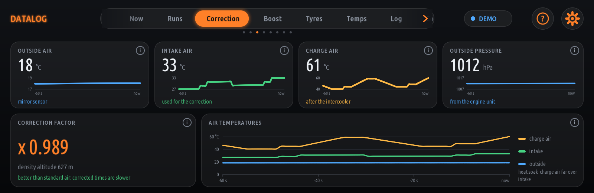 |
| Boost |  |
| Tyres | 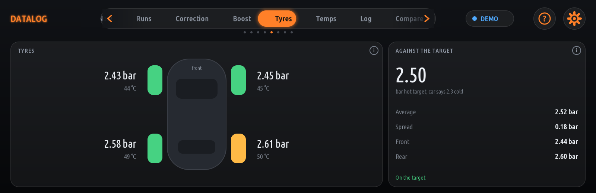 |
| Temps |  |
| Log |  |
| Compare |  |
| How to use |  |
| Settings |  |
| Card info | 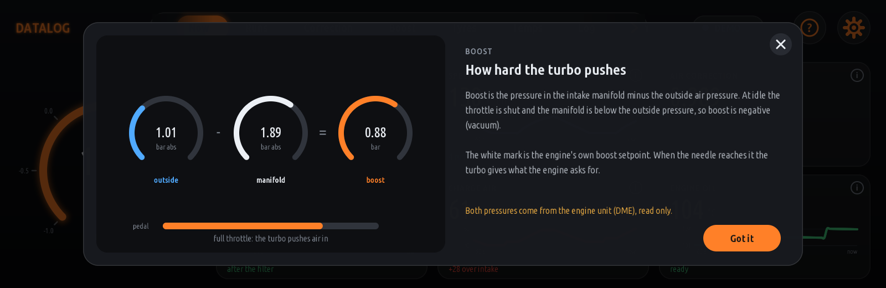 |

#### Pages

- **Now:** boost against the target, the run in progress, the air and the temperatures at a glance.
- **Runs:** every saved run with its time, trap speed and the air it was made in. Tap a run to compare it with the best one.
- **Correction:** the SAE J1349 correction factor and the density altitude from the intake temperature and the outside air pressure.
- **Boost:** the last minute of boost and target, and how far the engine fell short.
- **Tyres:** pressure and temperature of each tyre against the hot target.
- **Temps:** oil, coolant, gearbox, intake, charge air and exhaust, each against its own limits.
- **Log:** what happened, in order: runs, heat soak, demo on or off.
- **Compare:** speed over time for the best run and the chosen one, with the difference at each split.

Every card has an (i) that explains it, and How to use walks through the app.

#### What it reads from the car

Speed, engine speed, oil and coolant temperature (CDS, Vehicle2), the outside temperature, the gearbox
oil temperature and the tyre pressures and temperatures. From the engine unit (DME) it reads the boost
pressure and its setpoint, the outside air pressure, the intake and charge air temperatures and the
catalyst temperature, through the kit's read-only link, which refuses any request that is not a read.
The identifiers are in `app.json` (`config.dme`), BMW's own first and the standard OBD ones after them;
add your engine's identifier at the top of a list if a card stays empty.

#### Limits

- Runs are timed from the car's speed signal, not GPS: good for comparing runs on one car, not a timeslip.
- The exhaust value is the engine's catalyst model, not a sensor in the manifold.
- Values the engine unit does not answer stay empty; the rest of the app works without them.
- Runs are kept on the head unit (the last 30), in the app's data folder.

#### Settings

- **Renderer, Frame rate, Follow ambient lighting, Demo data:** the same in every Paget96 Garage app.
- **Run length:** 201 m or 402 m.
- **Corrected times:** show run times corrected to standard air.
- **Boost mark:** the target line on the Boost page when the engine sends no setpoint.
- **Tyre target (hot):** the pressure the Tyres page compares each tyre with.

## Coming next

These are design previews: drawn to show the look and the pages before the app is built. The numbers
in them are made up.

### Datalog (the design preview; the built app is above)

Times and performance for a closed track or strip: 402 m, 201 m and half mile runs, 0 to 100 and
60 to 100, trap speed, a weather corrected time next to the real one, a dyno sheet from one pull,
boost explained (manifold pressure minus outside pressure), the three air temperatures (outside,
after the filter, before the throttle), tyres cold to hot, engine and gearbox temperatures, a log
and a side by side compare.

| Now | Runs | Dyno |
|---|---|---|
| 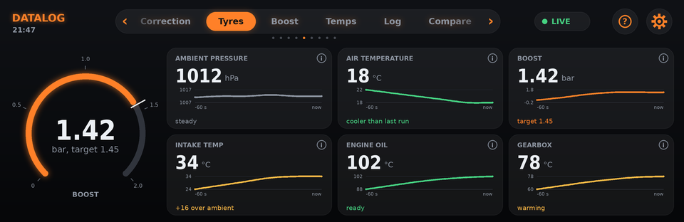 | 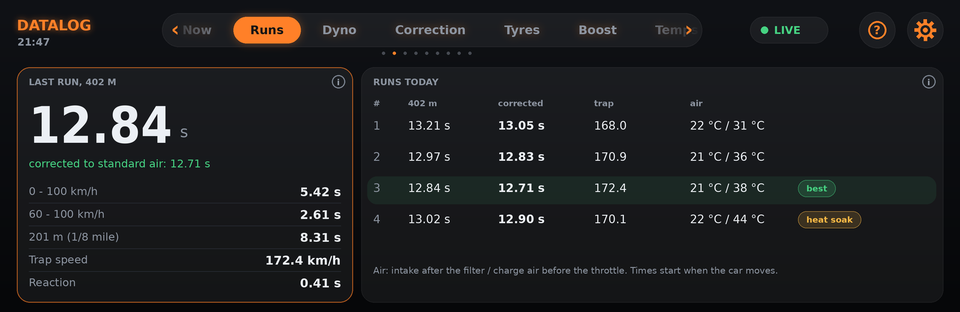 | 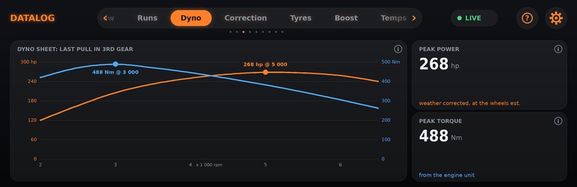 |

| Correction | Boost | How boost works |
|---|---|---|
| 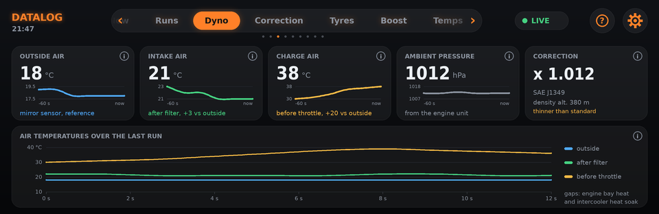 | 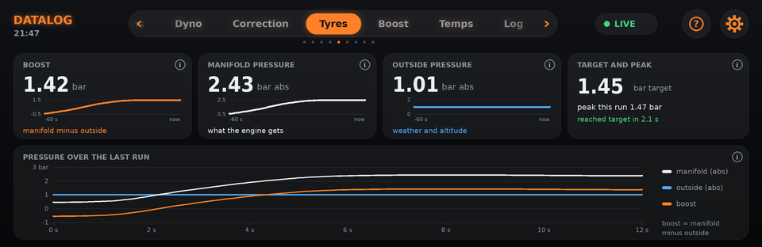 | 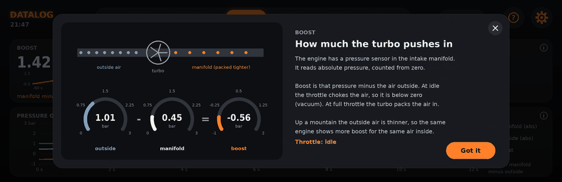 |

### Exhaust (designed)

The exhaust from the engine to the tail pipe: live temperatures on every part, the exhaust flap with
your own rules (open above an engine speed, in Sport, at full throttle; closed on a cold start or at
night), the particulate filter with its regenerations, how the sound is made and what damps it, and
tips for a better sound without changing anything. A setup page records what your exhaust has.

| Now | Flap and its rules |
|---|---|
| 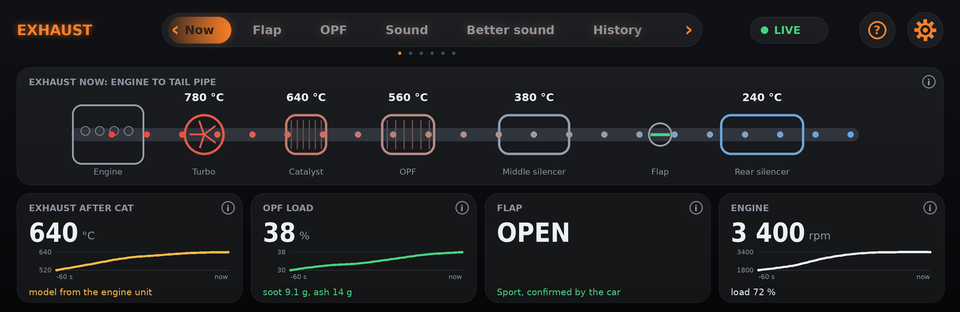 | 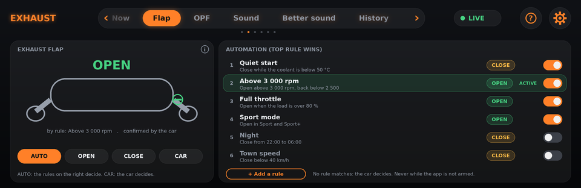 |

| Particulate filter | How the sound is made | Setup |
|---|---|---|
| 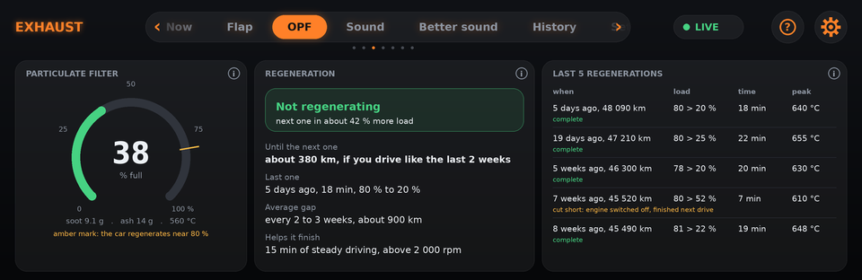 | 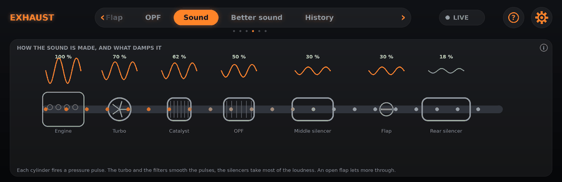 | 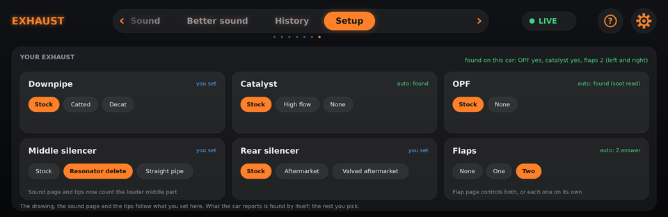 |

### Standby (designed)

A calm screen for waiting and night driving: a big clock whose digits never move, the outside
temperature with an ice warning, the 12 V battery, range, doors and windows, seat and wheel heating
and the climate, at a glance. At night it dims to a warm dark colour.

| Clock | At night | Glance |
|---|---|---|
| 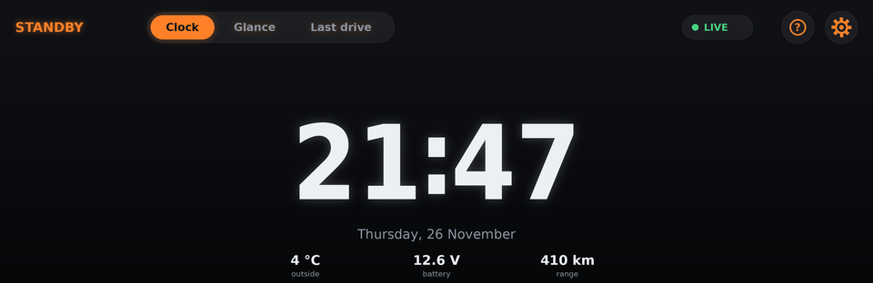 |  | 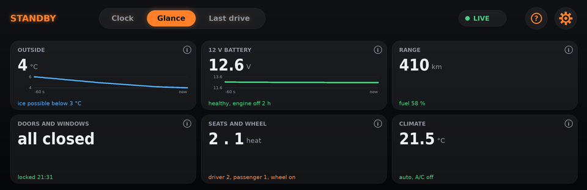 |

## How every app works

Every Paget96 Garage app follows the same rules, so once you know one, you know them all.

- **One look.** Dark glass cards, the app name and a small clock top left, page tabs on top that
  scroll when there are many, How to use (?) and Settings (gear) top right.
- **One app per topic.** No thirty small apps: each app holds everything about its topic.
- **Every card explains itself.** Tap a card with an (i) for what it shows, where the value comes from
  and what is normal, with a picture or an animation.
- **Every chart has its values.** Axes with numbers and units; rings show their scale.
- **Smooth.** Everything moves at 60 fps: values glide, nothing jumps. Frame rate and renderer can be
  changed in Settings (60 fps is the default).
- **Only what your car has.** A card, page or button appears only when your car reports that value or
  has that function.
- **Colours mean something.** Green is fine, amber look at it soon, red now. The accent follows your
  front ambient light, but data colours never change.
- **Read first.** The apps read what the car already reports. The only things they ever change, and
  only when you tap and confirm: clearing the fault memory and resetting a service item (Health),
  and the exhaust flap (Exhaust).
- **Your popups stay on top.** An app must never cover the car's own popups (work in progress).

## Building

You need Python 3 and Node.js (the head unit runs Node 8.16.2 and Python 3.12; code stays Node 8
compatible). BMW's oap-sdk is not in this repository and never will be: the MGU Store takes it
from the head unit. For a local build, put your own copy in `oap-sdk/` (ignored by git).

```
python tools/build.py <app id>      # dist/<id>@<version>.tgz
python tools/check_docs.py          # every app documented, icons in spec, no em dashes
node tools/ui_demo.js               # the Paget96 Garage UI reference page, docs/design/ui-demo.png
python tools/make_icon.py clock apps/<id>/icon.png
```

How the pieces fit:

- `upstream-kit/` is a pinned copy of the kit from
  [idrive7-apps](https://github.com/cauliflowermossgrape/idrive7-apps) (the commit is in
  [NOTICE](NOTICE)). It is vendored, not a submodule, because the MGU Store does not fetch
  submodules. Refresh it with `python tools/sync_upstream_kit.py <idrive7-apps checkout> [<commit>]`.
- `tools/build.py` stages a tree upstream's build understands and runs it.
- `lib/ui.js` is the Paget96 Garage look on top of the kit ([docs/DESIGN.md](docs/DESIGN.md)).
- `mgu-repo.json` tells the MGU Store how to build each app.
- Icons follow one template ([docs/ICONS.md](docs/ICONS.md)).

## Contributing

Issues and pull requests are welcome. Anything that is useful beyond Paget96 Garage (a fix in the kit, a
new signal) goes to [idrive7-apps](https://github.com/cauliflowermossgrape/idrive7-apps) as a pull
request first, and comes here with the next kit sync. App ids start with `p96_`. Text never uses
an em dash or an en dash.

## Credits

- The app kit (runtime, GPU renderer, build tools) is
  [idrive7-apps](https://github.com/cauliflowermossgrape/idrive7-apps) by cauliflowermossgrape and
  contributors, MIT licensed. See [NOTICE](NOTICE).
- Installation and updates: [MGU Store](https://github.com/robertnisipeanu/mgu-store) by
  robertnisipeanu.

## Disclaimer

These apps run on a rooted head unit. Rooting and installing third-party software is at your own
risk and may affect your warranty. The apps only read data the car already reports, except where
an app's own section names a write. Do not use them in a way that distracts you while driving.
Paget96 Garage is not affiliated with, endorsed by or connected to BMW AG. BMW and iDrive are
trademarks of BMW AG.

## License

Copyright (c) 2026 Danijel Markov (Paget96).

The code is free software under the [GNU GPL v3](LICENSE) (GPL-3.0-only) with additional terms in
[NOTICE](NOTICE): every copy or changed version must keep our credit and show it in the app,

> Based on Paget96 Garage by Danijel Markov (Paget96) - github.com/Paget96/Paget96-Garage

a changed version must be marked as changed and use its own name and icons, and the names and brand
are not licensed ([TRADEMARKS.md](TRADEMARKS.md)). The vendored kit in `upstream-kit/` keeps its own
MIT license ([upstream-kit/LICENSE](upstream-kit/LICENSE)).
