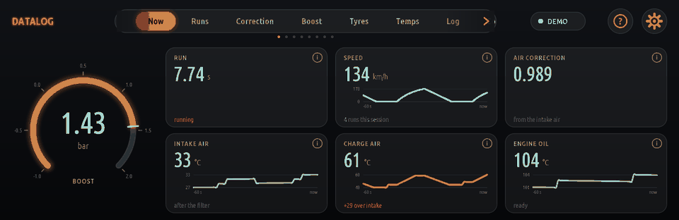
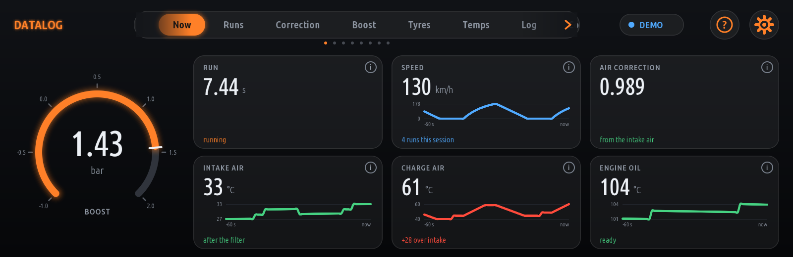
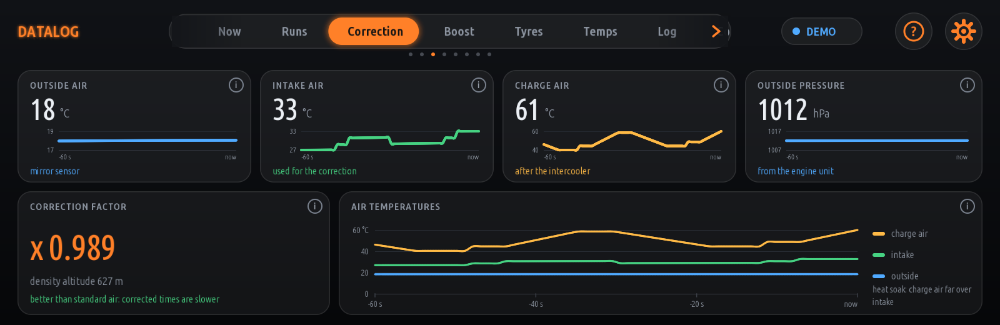
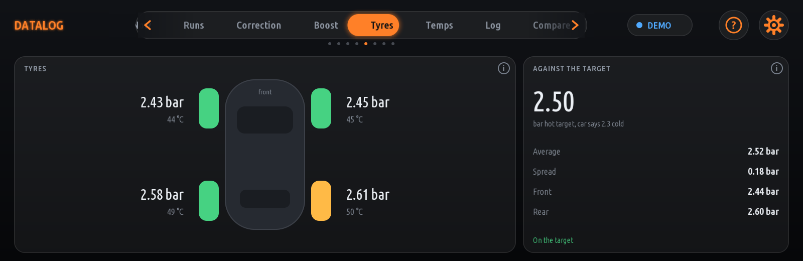
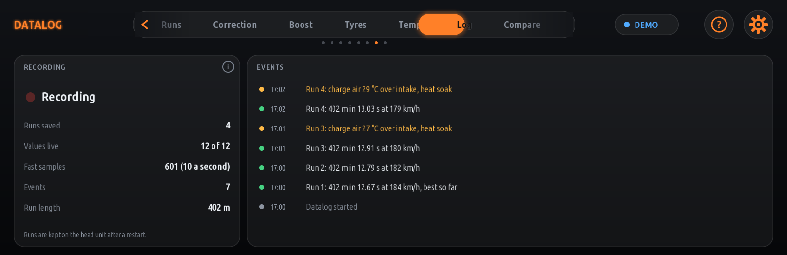
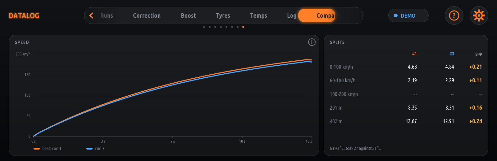
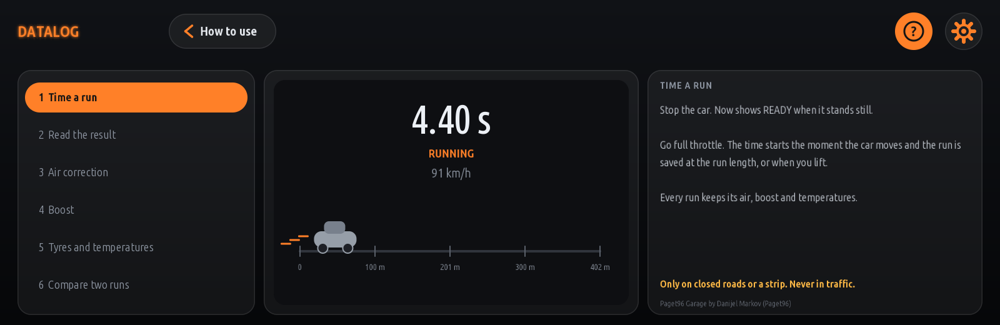
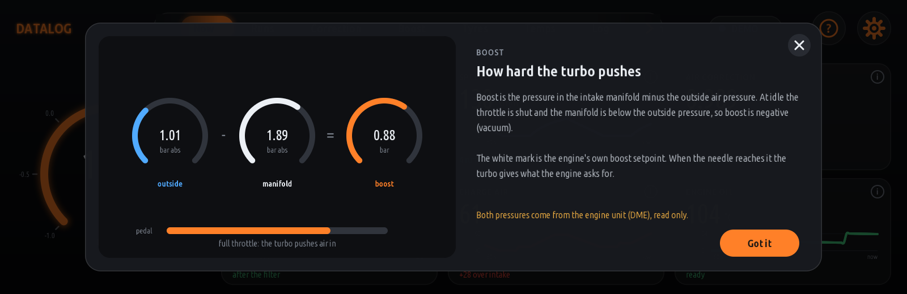

# Datalog

Datalog records every pull. It times each run from a standstill, keeps the boost the engine made
against the boost it asked for, the intake, charge air and exhaust temperatures, and the air the run
was made in, so two runs on different days can be compared fairly. Everything comes from the car and
the engine unit; Datalog only reads.

| Page | Screenshot |
|---|---|
| Now |  |
| Runs |  |
| Correction |  |
| Boost |  |
| Tyres |  |
| Temps |  |
| Log |  |
| Compare |  |
| How to use |  |
| Settings |  |
| Card info |  |

## Pages

- **Now:** boost against the target, the run in progress, the air and the temperatures at a glance.
- **Runs:** every saved run with its time, trap speed and the air it was made in. Tap a run to compare it with the best one.
- **Correction:** the SAE J1349 correction factor and the density altitude from the intake temperature and the outside air pressure.
- **Boost:** the last minute of boost and target, and how far the engine fell short.
- **Tyres:** pressure and temperature of each tyre against the hot target.
- **Temps:** oil, coolant, gearbox, intake, charge air and exhaust, each against its own limits.
- **Log:** what happened, in order: runs, heat soak, demo on or off.
- **Compare:** speed over time for the best run and the chosen one, with the difference at each split.

Every card has an (i) that explains it, and How to use walks through the app.

## What it reads from the car

Speed, engine speed, oil and coolant temperature (CDS, Vehicle2), the outside temperature, the gearbox
oil temperature and the tyre pressures and temperatures. From the engine unit (DME) it reads the boost
pressure and its setpoint, the outside air pressure, the intake and charge air temperatures and the
catalyst temperature, through the kit's read-only link, which refuses any request that is not a read.
The identifiers are in `app.json` (`config.dme`), BMW's own first and the standard OBD ones after them;
add your engine's identifier at the top of a list if a card stays empty.

## Limits

- Runs are timed from the car's speed signal, not GPS: good for comparing runs on one car, not a timeslip.
- The exhaust value is the engine's catalyst model, not a sensor in the manifold.
- Values the engine unit does not answer stay empty; the rest of the app works without them.
- Runs are kept on the head unit (the last 30), in the app's data folder.

## Settings

- **Renderer, Frame rate, Follow ambient lighting, Demo data:** the same in every Paget96 Garage app.
- **Run length:** 201 m or 402 m.
- **Corrected times:** show run times corrected to standard air.
- **Boost mark:** the target line on the Boost page when the engine sends no setpoint.
- **Tyre target (hot):** the pressure the Tyres page compares each tyre with.
