# Datalog

Part of [Paget96 Garage](../../README.md), by Danijel Markov (Paget96).

Your car's strip day in one app. Datalog times 201 m, 402 m and 1/2 mile runs from a standstill, with 0 to 100 km/h,
60 to 100 km/h, 201 m, the trap speed and your reaction, and corrects every time to standard air (SAE J1349) so runs
on different days compare fairly. Next to that: a dyno sheet from a full throttle pull, the boost and the wastegate, the three air
temperatures from the mirror to the throttle, the tyres from cold to hot, the fluids, a log of every run and two runs
side by side.

Datalog shows only what your car reports: a page, card, chart line or setting appears once your car has sent that
value (remembered for this car). Demo data shows everything a car of the chosen Demo car has.

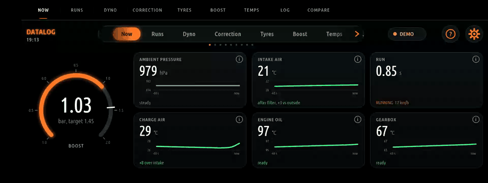

| Page | Screenshot |
|---|---|
| Now: boost, the air, the run, oil and gearbox |  |
| Runs: the last run and every run today | 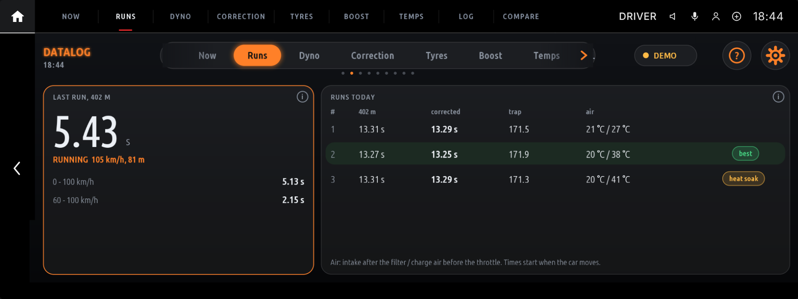 |
| Dyno: power and torque over the rev range | 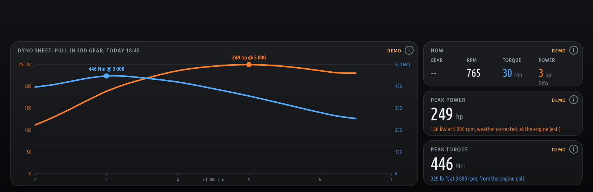 |
| Correction: three air temperatures, pressure, the SAE factor |  |
| Tyres: pressure and temperature, cold to hot |  |
| Boost: manifold minus outside, target and peak, the wastegate | 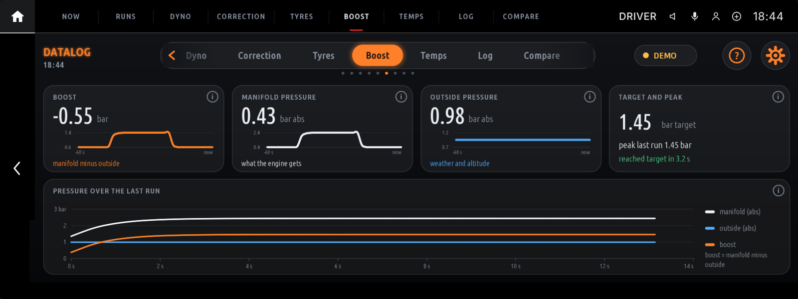 |
| Temps: oil, coolant, gearbox, air, exhaust, 10 minutes | 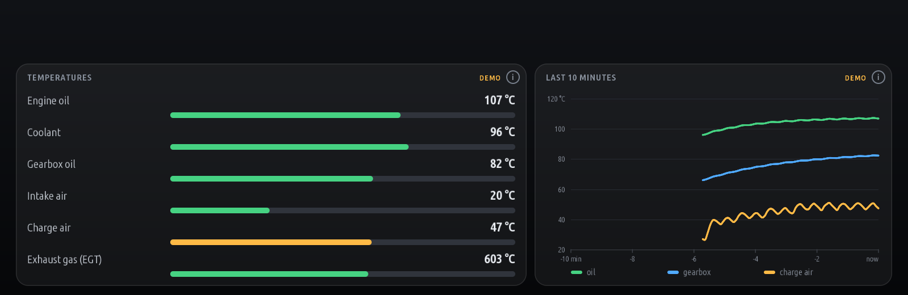 |
| Log: sessions and their runs |  |
| Log: a run opened | 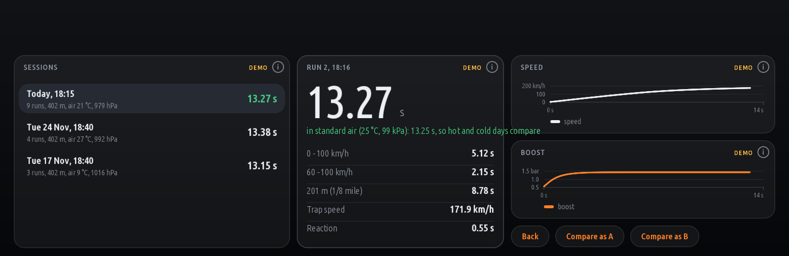 |
| Compare: two runs, every split, boost, charge air, the air |  |
| Info popup: boost, animated | 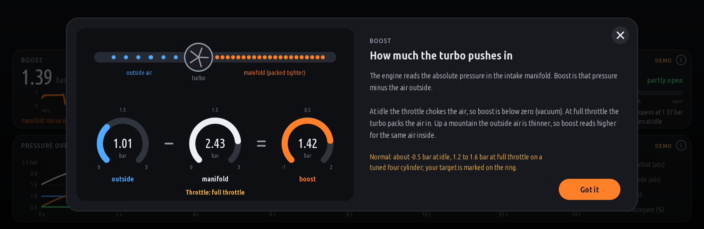 |
| Info popup: charge air, the air path | 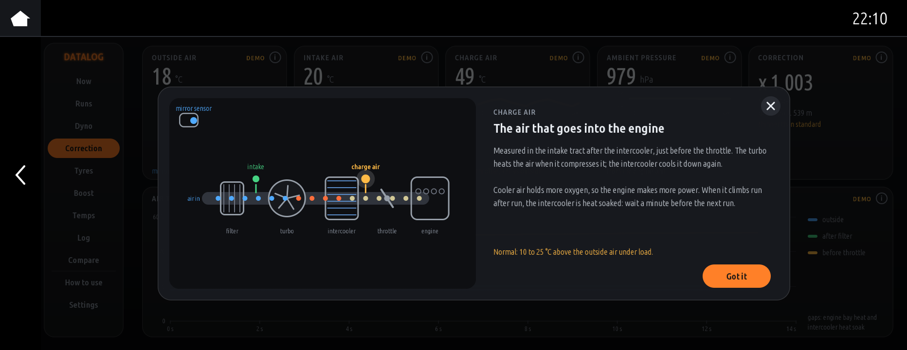 |
| Info popup: the dyno sheet |  |
| Info popup: the wastegate, gas through the turbine or past it | 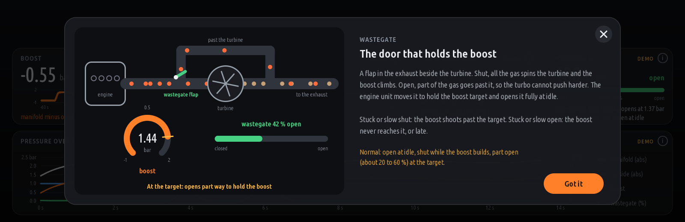 |
| How to use |  |
| Settings | 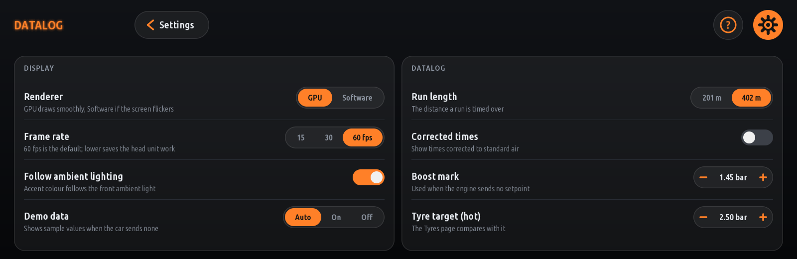 |

The screenshots and GIFs come from the upstream emulator (the car's own draw engine) on demo data.

**What it reads from the car.** Only reads, never writes. From the car's own broadcasts: speed, engine speed, engine
torque, the gear, oil and coolant temperature, the gearbox oil temperature, the outside temperature (mirror sensor) and
the tyre pressures and temperatures (TPMS). From the engine unit, with read requests only (UDS 22, through the kit's
read only diagnostic link) and only while Datalog's screen is shown: the intake air after the filter, the charge air
before the throttle, the intake manifold pressure, the outside air pressure, the boost target, the engine's own torque
figure, the accelerator pedal, the exhaust gas temperature model and, on engines with an electric wastegate, its
position and the duty cycle at its actuator. When Datalog is not on the screen nothing goes on
the bus; runs are still timed from the broadcasts.

**How it works out the numbers.**

- Times start when the car moves (0.5 km/h), so the reaction (throttle to moving) is shown on its own. Crossing
  moments are worked out between speed samples, so they do not depend on how often the car sends speed.
- Weather correction: SAE J1349 from the intake air temperature and the outside pressure at the launch, as dry air.
  Distances are corrected by the cube root of the factor, speed windows by the factor, the trap speed the other way.
  The raw time is always shown next to the corrected one.
- Boost = intake manifold pressure minus the outside pressure, so it is below zero (vacuum) at idle.
- Wastegate: its position, 0 % shut to 100 % open, on the Boost page and as its own line on the right axis of the
  pressure chart. The card says in words when it opened and closed in the last run (shut while the boost builds,
  the boost at which it opened to hold the target, how it sits at idle), and warns when the boost went 0.15 bar or
  more past the target or stayed that much short of it (a wastegate stuck or slow shut, or open). Shown only when
  the engine reports it.
- Dyno: a pull is full throttle in one gear (2nd or higher) with the rpm climbing over at least 1 500 rpm. Torque is
  the engine unit's own figure; power = torque x rpm / 7 121 (hp). Both corrected to standard air.

**Limits.**

- The dyno sheet is an estimate at the engine from the engine unit's own torque figure: not a real dyno, and not at
  the wheels (where 10 to 15 % less arrives).
- The car reports no humidity, so the correction treats the air as dry. A turbo engine makes up some of the thin air
  itself, so the correction overstates its loss up high.
- The engine unit values are read only while the screen is shown, so a run timed with Datalog in the background has
  no boost or air trace.
- The exhaust gas temperature is the engine unit's model, not a sensor, and not every engine has it.
- The wastegate position is the engine unit's own reading of its electric actuator; engines with a vacuum wastegate
  do not report one, and the engine unit gives no wastegate target to compare with.
- The identifiers are BMW's DME8FF_R ones (B38, B48, B58, the V8s' engine units in the same family); a diesel's
  engine unit answers some of them. Not tried on a car yet: tested with demo data in the PC preview and the emulator.
  ID7 head units only (iDrive 8 is not tried yet).

**Works with.** Every BMW with the MGU Store on an iDrive 7 head unit, whatever its engine. Four and six cylinders
with one turbo: boost, the electric wastegate, the dyno. Two turbos (S58): both drawn in the air path and the
wastegate picture. A V8 with two engine units (N63, S63, S68): boost and wastegate of bank 1 and bank 2 side by side,
bank 2 from its own engine unit. Diesels (B47, B57): boost and the dyno, no wastegate card (their turbo has variable
vanes). A plug-in hybrid: the engine values while the engine runs. An electric car: the speed ring, runs, tyres and
temperatures; no Boost or Dyno page. The engine is found from the car's own answers, never assumed; Settings,
Demo car shows each layout.

| Car | Screenshot |
|---|---|
| V8, two engine units: boost of both banks, both wastegates | 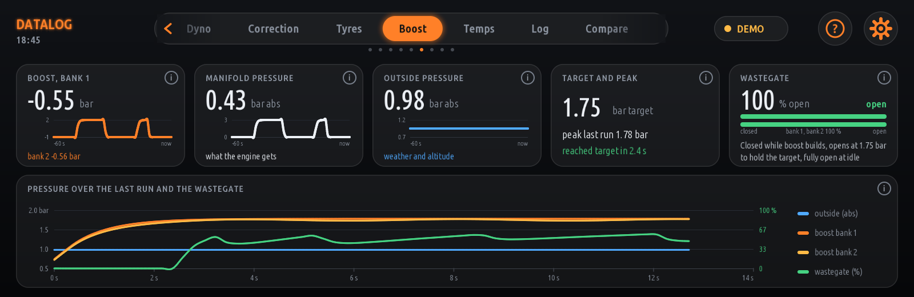 |
| S58, two turbos: the wastegate explained for both | 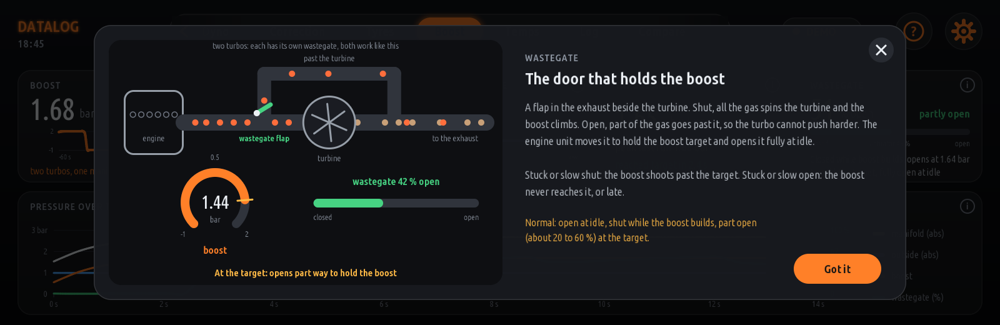 |
| Electric: the speed ring in place of the boost |  |

**Settings.** The Display block (the same in every Paget96 Garage app): Renderer, Frame rate (60 fps by default), Full screen (on by default),
Follow ambient lighting, Demo data (Off or On, Off by default; while it is on the header says DEMO, tap it to turn it off), and while the demo runs Demo car (B48, B58, S58, S63 V8, B57 diesel, PHEV or EV). Then Datalog's own: Run length (201 m, 402 m or 1/2 mile), Boost target (the
mark on the boost ring, 1.45 bar by default), Tyre target (hot, 2.40 bar by default, the Tyres page compares with it)
and Units (metric or imperial).

**Send a report** sits at the top of the Settings page, and How to use explains it: a QR code that your phone opens as
a filled-in GitHub issue, after a screen that shows every line it carries ([Send a report](../../README.md#send-a-report)).

