# Exhaust

Part of [Paget96 Garage](../../README.md) by Danijel Markov (Paget96), id `p96_exhaust`.

The exhaust from the engine to the tail pipe. Exhaust shows the gas on its way with the temperatures the engine
unit reports, runs the exhaust flap with your own rules, watches the particulate filter (OPF) and its
regenerations, tells you when your drives are too short for the filter, times the catalyst warm-up after a cold
start, draws how the sound is made and what damps it, and lists what gives a better sound without changing
anything on the car. A Setup page records what your exhaust has, and the drawings follow it.

Exhaust shows only what your car reports: the Flap pages appear when the engine unit answers for an electric
flap, the filter pages when it reports soot or load, and a rule can only use a value your car sends. The
screenshots use demo data (Demo data On, so the header shows the amber DEMO pill and every card says DEMO), which shows everything.

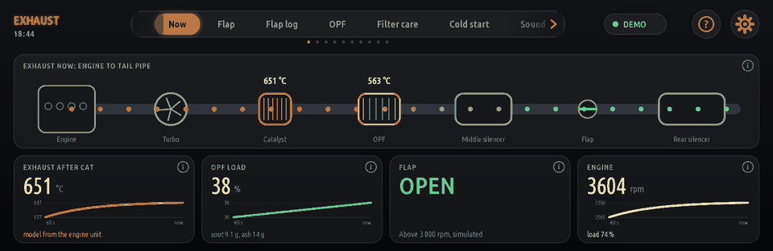

| Page | Screenshot |
|---|---|
| Home: the flap and its four buttons, the numbers that matter (the app opens here) | 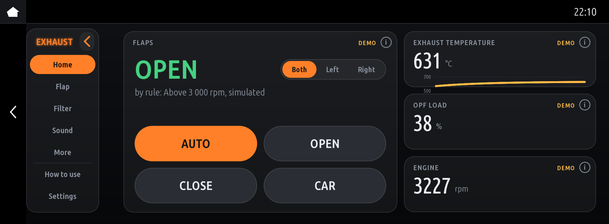 |
| More, Exhaust path: engine to tail pipe, live | 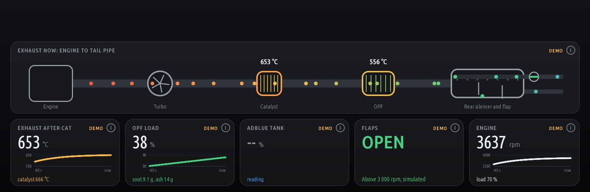 |
| Flap, Rules: the top rule that holds wins | 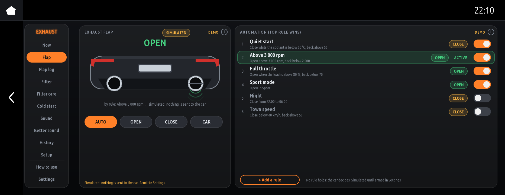 |
| Flap: a car with two flaps | 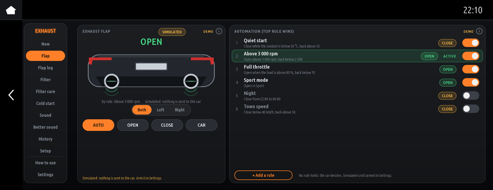 |
| Flap: add a rule | 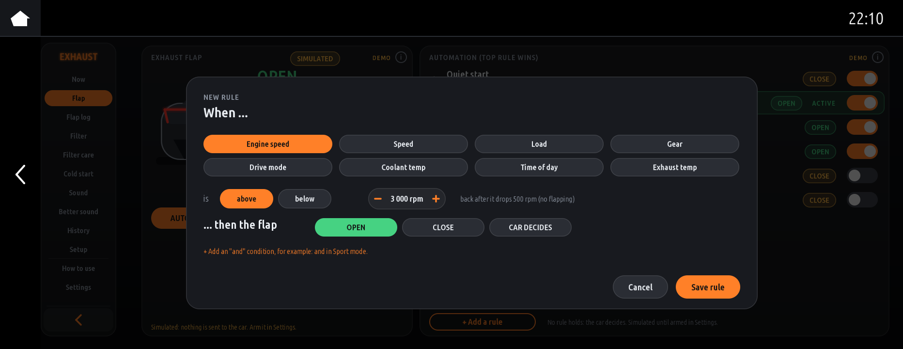 |
| Flap: change a rule, with an "and" | 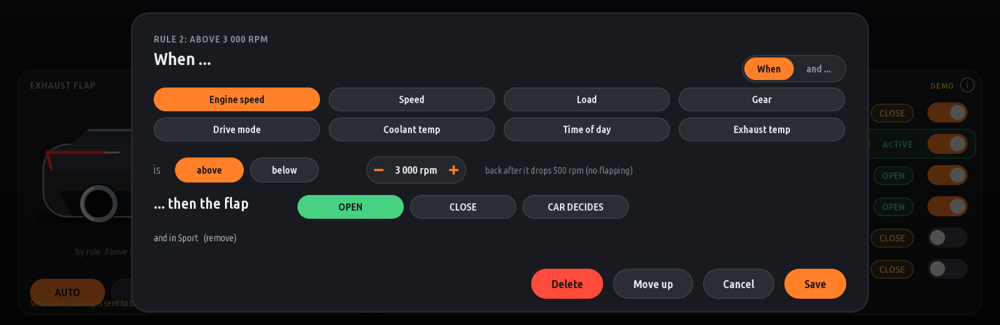 |
| Flap log: the week and every change | 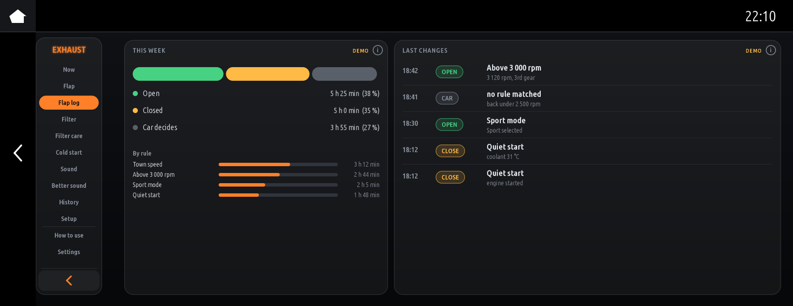 |
| OPF: load, regeneration, the last five | 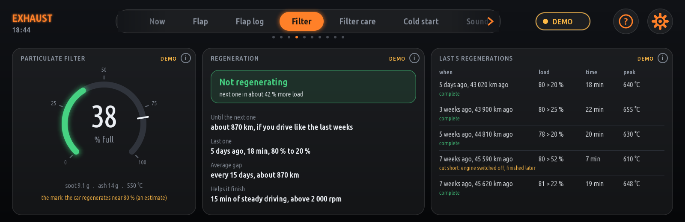 |
| OPF: regenerating now | 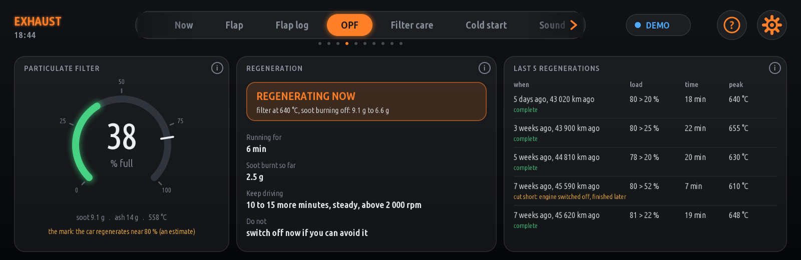 |
| Filter care: short drives, ash | 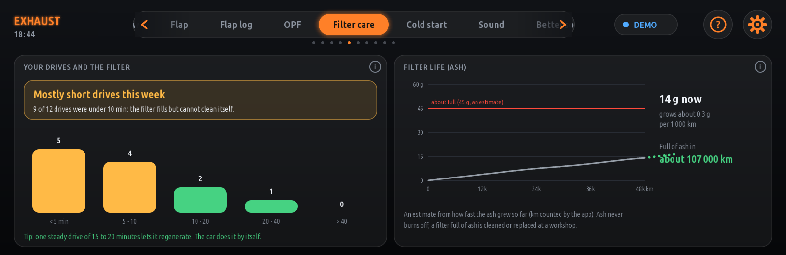 |
| Cold start: the catalyst warm-up | 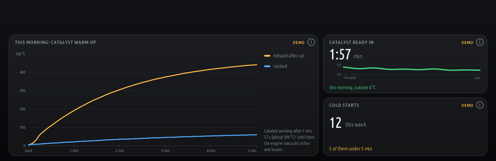 |
| Sound: what each part damps | 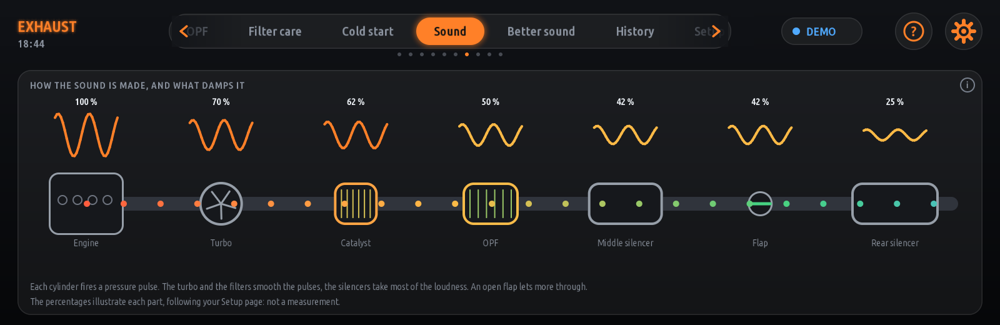 |
| Better sound: tips checked live | 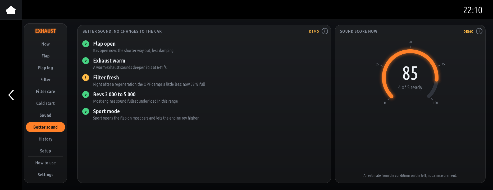 |
| History: 8 weeks of the filter | 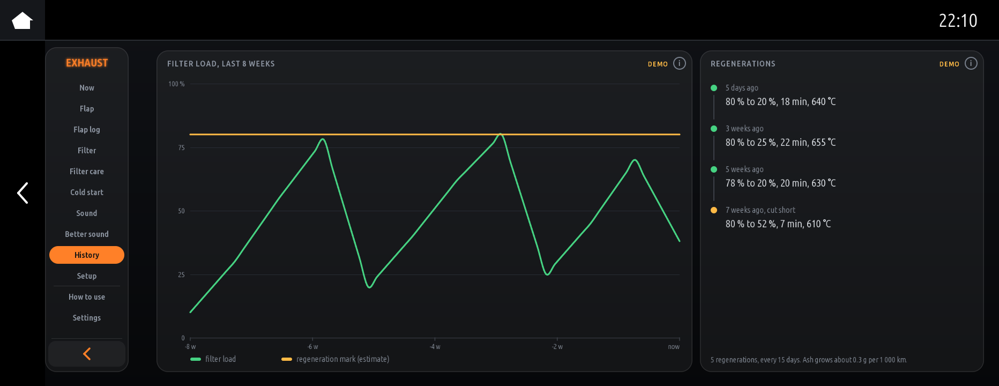 |
| Setup: what your exhaust has | 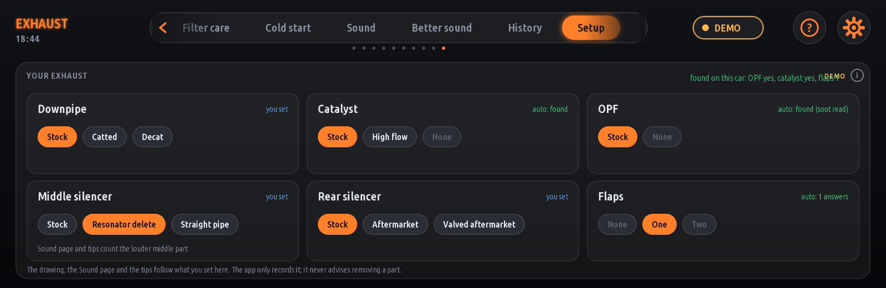 |
| Arming the flap control | 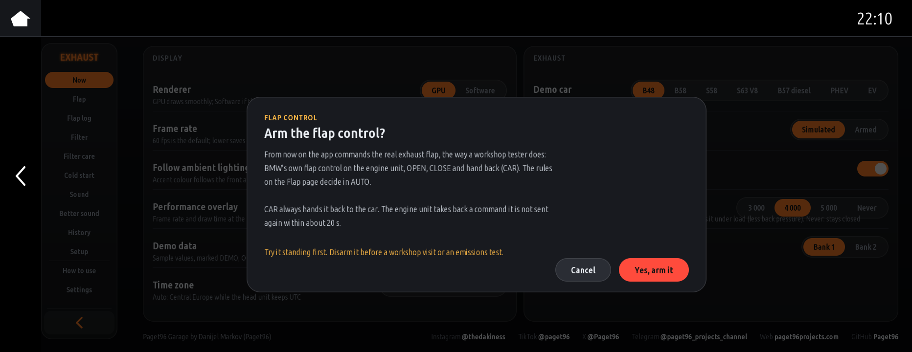 |
| Info popup (every card has an (i)) | 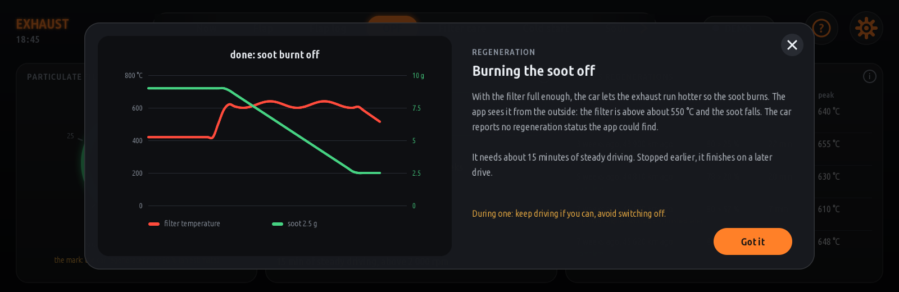 |
| How to use | 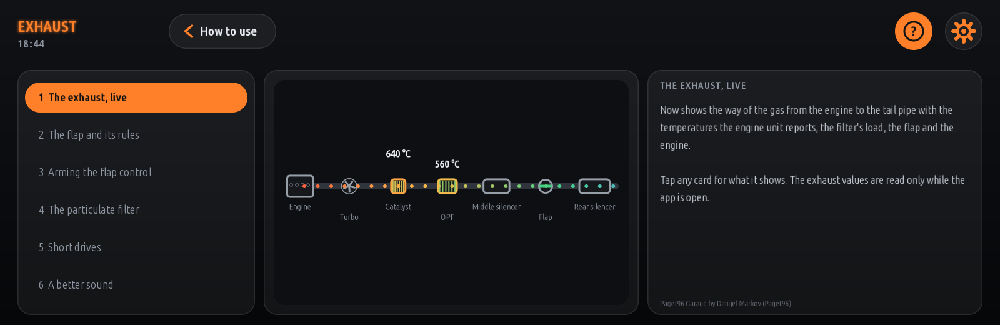 |
| Settings | 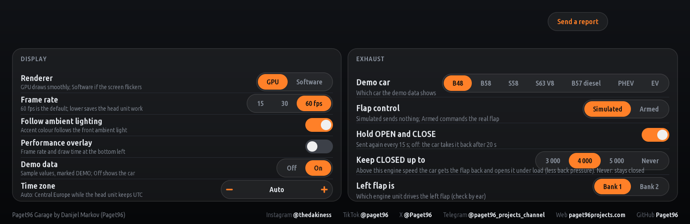 |

Every card's info popup is in [docs/media/p96_exhaust/popups/](../../docs/media/p96_exhaust/popups/).

## The flap and its rules

AUTO lets your rules decide: an ordered list, the top rule that is switched on and
holds wins, and when none holds the car decides. A rule is "when engine speed, speed, load, gear, drive mode,
coolant temperature, time of day or exhaust temperature is above or below a value (and optionally a second
condition), then the flap OPEN, CLOSE or CAR DECIDES". Every number has a margin ("above 3 000 rpm" opens above
3 000 and closes only below 2 500), so the flap does not click at the edge. OPEN and CLOSE hold the flap; CAR
hands it back. With two flaps (a V8 with two engine units) each can be set on its own.

## What it writes, and only this

The exhaust flap, the way upstream's
[Engine Config](https://github.com/cauliflowermossgrape/idrive7-apps/tree/main/apps/live_adjustments) does it:
BMW's own flap control on the engine unit (2F 60 FD: open at 10 %, close at 90 %, hand back), sent again every
15 s because the engine unit lets a tester's command go after about 20 s. Out of the box it is **simulated**:
nothing is sent until you arm it in Settings and confirm. Opening the app sends nothing by itself; a command
leaves only on a button press, a change of what your rules decide, or the car coming up with OPEN, CLOSE or AUTO
kept. What was asked, whether the engine unit took it and what was read back are shown apart, and a request is
never shown as done without the read-back. CLOSE is handed back to the car above an engine speed you set
(4 000 rpm by default) and when there is no engine speed. Disarming hands every flap back first.

## What it reads from the car

From the car's broadcasts: engine speed, speed (Exhaust counts the km it sees),
gear, drive mode, coolant and outside temperature. From the engine unit, only while Exhaust's screen is shown:
soot, ash and the load of the particulate filter, its temperature, the exhaust temperature after the catalyst (the
engine unit's model), the exhaust camshaft and the engine load; and the flap's state.

## Limits

- A regeneration is seen from the outside (the filter hot and the soot falling): the car reports no regeneration
  status Exhaust could find. Only regenerations while the app is open are seen.
- The regeneration mark (about 80 %), the point where a filter counts as full of ash (45 g) and the catalyst's
  working temperature (300 °C) are estimates; the car does not report them.
- The km are the ones Exhaust counted from the speed, not the odometer.
- Rules on load and exhaust temperature work only while the app is open; the others work in the background too.
- The sound percentages illustrate each part; they are not a measurement. The app records your setup and never
  advises removing a catalyst or a filter.
- Which engine unit drives the left flap on a car with two is not known yet: there is a setting for it.
- Tested on the PC preview with demo data and a pretend engine unit only. ID7 head units only for now.

**Works with.** Every BMW with an engine where the MGU Store runs on iDrive 7. The drawing shows the car's own
cylinders, one or two turbos and one or two pipes. One flap (60 FD) or a V8's two flaps, each on its own engine unit
(61 1E, as upstream does). Petrol cars: the OPF page. Diesels: the DPF page and words, the SCR catalyst in the drawing
and the AdBlue tank when the engine unit reports it. A plug-in hybrid: the values while the engine runs. An electric
car has no exhaust: the app says so on its one page and reads nothing. Settings, Demo car shows each layout.

| Car | Screenshot |
|---|---|
| V8: two banks, two turbos, two pipes, two flaps | 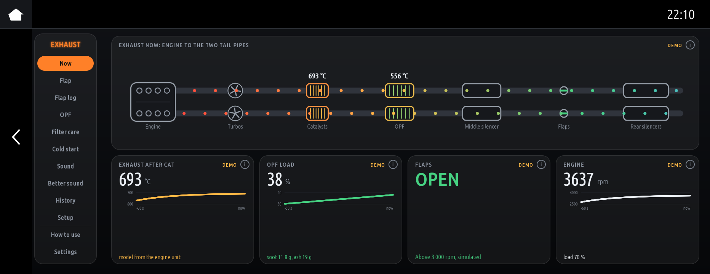 |
| Diesel: DPF, SCR and the AdBlue tank | 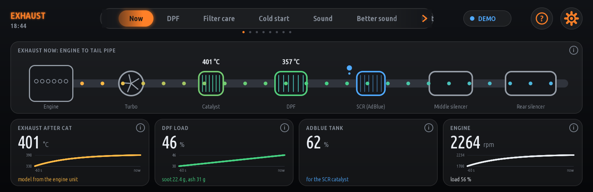 |
| Electric: no exhaust | 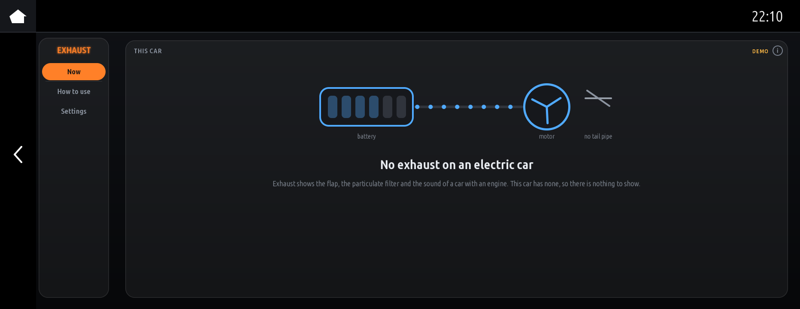 |

## Settings

The Display block (the same in every Paget96 Garage app): Renderer, Frame rate (60 fps by default), Full screen (on by default),
Follow ambient lighting, Demo data (Off or On, Off by default; while it is on the header says DEMO, tap it to turn it off), and while the demo runs Demo car (B48, B58, S58, S63 V8, B57 diesel, PHEV or EV). Then Exhaust's own: Flap control (Simulated or Armed, with a confirmation),
Hold OPEN and CLOSE (sent again every 15 s), Keep CLOSED up to (3 000, 4 000, 5 000 rpm or never), and on a
car with two flaps, Left flap is (bank 1 or 2).

**Send a report** sits at the top of the Settings page, and How to use explains it: a QR code that your phone opens as
a filled-in GitHub issue, after a screen that shows every line it carries ([Send a report](../../README.md#send-a-report)).

## Bigger, and a button for the flap

Exhaust is drawn 1.5 times bigger than the other apps' first layout, to be read from the seat, with fewer things on a
page. The menu holds five groups (Home, Flap, the filter, Sound, More); the group shown lists its pages under it.
Settings, When the app opens: Open, Open / auto or Close; save Exhaust on a favourite button of the car and one press
opens the app and sets the flap (only with the flap control armed). After a minute away the app comes back on Home.
