# Health

Part of [Paget96 Garage](../../README.md) by Danijel Markov (Paget96), id `p96_health`.

One look at the whole car: what the control units have stored, how the 12 V battery really is, what service
is due, whether a tyre is losing air, the fluids, and one score from 0 to 100 that sums it up. Every fault scan
is kept, so you see when a fault came and went. Save a report before you clear faults, and show the whole thing
to your mechanic as a QR code that any phone camera reads.

Health shows only what your car reports: a page, card, chart line, setting or button appears once your car
answers it (found the first time, remembered for that car). A car without tyre pressure sensors has no Tyres page,
and only the service items the car itself can reset get a Reset. The screenshots use demo data, which shows everything.

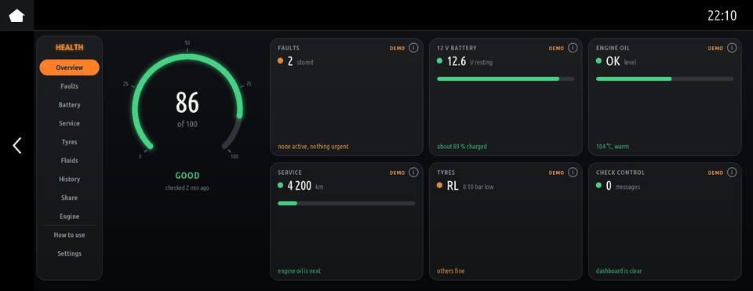

| Page | Screenshot |
|---|---|
| Overview: the score and six checks | 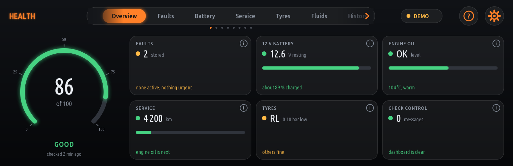 |
| Faults by unit: fault memory |  |
| Faults: info memory | 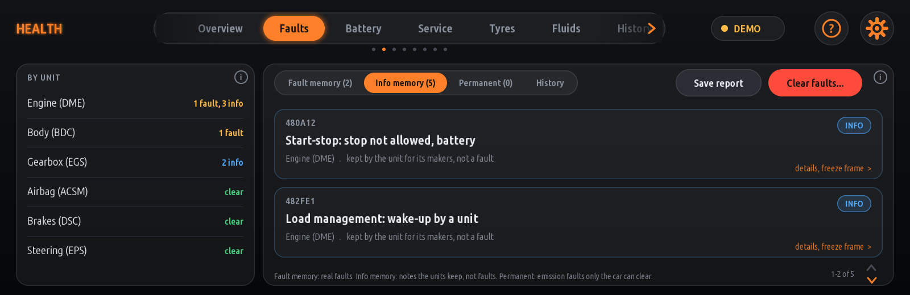 |
| Faults: permanent emission faults | 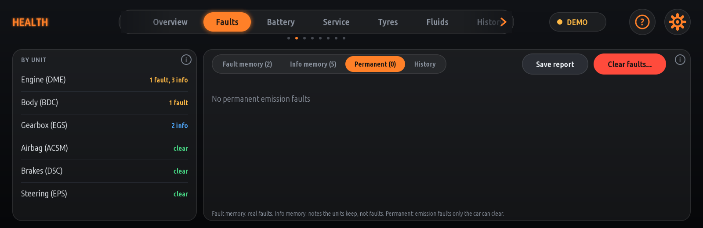 |
| Faults: one unit |  |
| Faults: details and freeze frame | 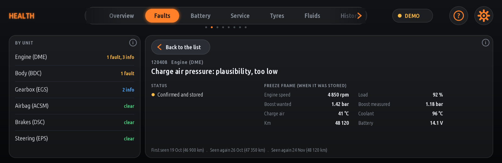 |
| Faults: history (every scan kept) | 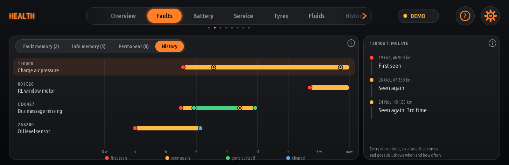 |
| Clear faults: the confirmation | 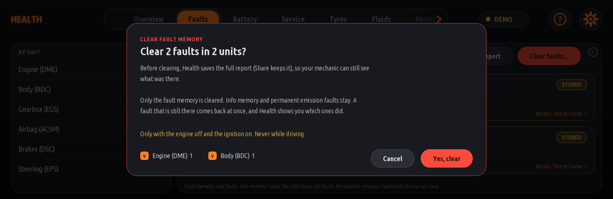 |
| Clear faults: what came back | 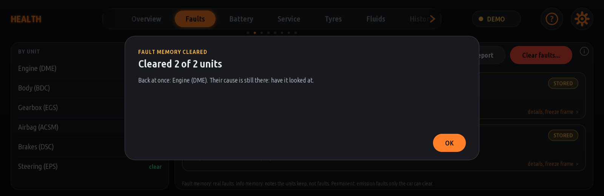 |
| Battery: resting voltage, start dip, charge, 14 nights | 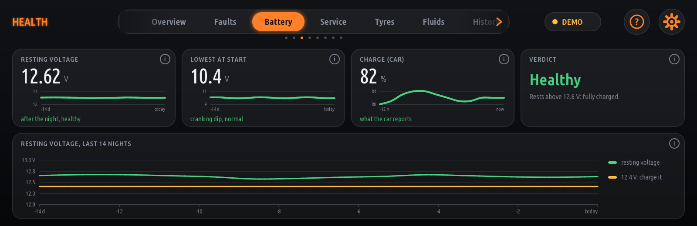 |
| Service: the car's items, our intervals, your parts | 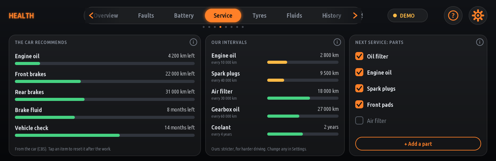 |
| Service: add a part | 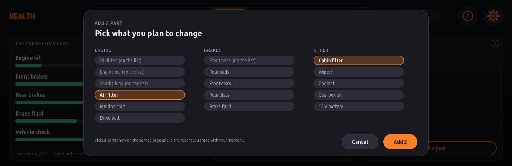 |
| Service: reset one of the car's items | 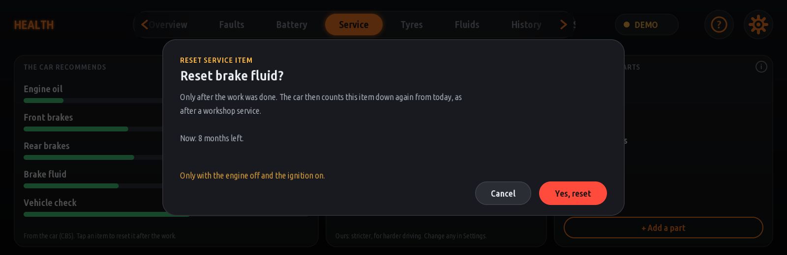 |
| Tyres: pressures and the 4 week trend | 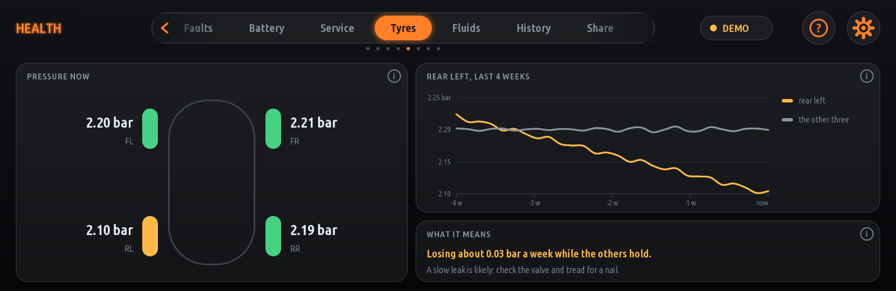 |
| Fluids: levels and warm-up | 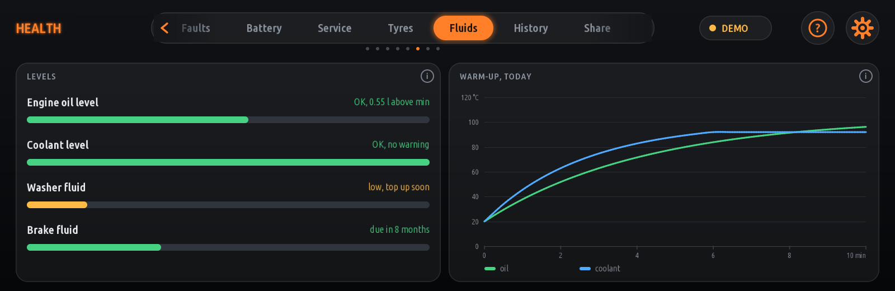 |
| History: score over 12 weeks, what changed | 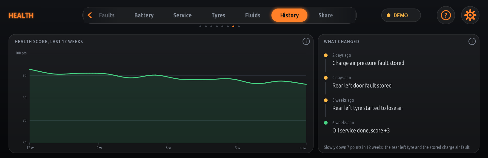 |
| Share: the report as a QR code | 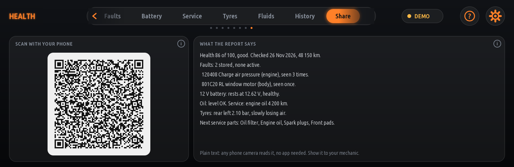 |
| A reminder when something is due | 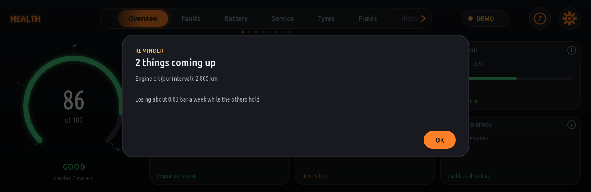 |
| Info popup (every card has an (i)) | 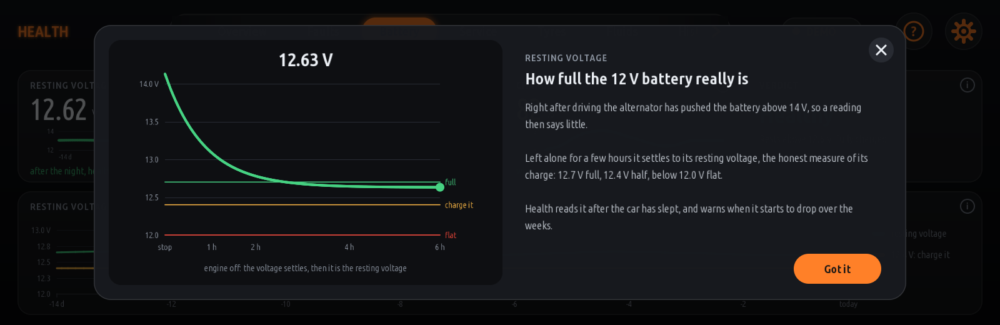 |
| How to use |  |
| Settings |  |

Every card's info popup is in [../../docs/media/p96_health/popups/](../../docs/media/p96_health/popups/).

**What it reads from the car.** From the car's own broadcasts: engine speed, oil and coolant temperature, the
12 V charge the battery sensor reports, the speed (Health counts the km it sees), the tyre pressures, the
service list the cluster shows, and the Check Control messages. Over the head unit's diagnostic link, only while
Health's screen is shown: the fault memory and info memory of every unit, the engine's permanent emission faults,
a fault's freeze frame when you open it, and from the engine unit the 12 V voltage, the oil level and the km on the
oil and spark plugs. Nothing is read in the background over the diagnostic link.

**What it writes, and only these two.** Both only when you tap and confirm, with the engine off and the ignition on,
never by themselves:

- **Clear faults** empties the fault memory of the units that hold a fault (UDS 14 FF FF FF), the way a workshop
  tester does. Health saves the full report first. Info memory and permanent emission faults stay. Afterwards it
  scans again and shows which faults came back at once: their cause is still there.
- **Reset a service item** (oil, front or rear brakes, brake fluid, vehicle check) in the instrument cluster, the
  workshop's own CBS reset, and only when the cluster itself says the item may be reset now. Afterwards the item is
  read again.

**Limits.**

- The 12 V resting voltage has no broadcast signal, so Health reads it the first time you open it after the car
  slept for 3 hours or more, with the engine off. A night you do not open Health has no reading.
- The dip at start is measured only when you start the engine with Health open.
- Fault texts: the car keeps none and BMW's text tables are not ours to share, so a fault Health has no words for
  shows its code and unit: look it up by both.
- Coolant and washer fluid have only a low warning in the car, no level.
- Air filter, gearbox oil and coolant are counted from when you mark them done on the Service page.
- Health cannot put up a notification on the screen: reminders show on its home-screen widget and once when you
  open the app.
- Tested on the PC preview with demo data only. ID7 head units only for now.

**Settings.** The Display block (the same in every Paget96 Garage app): Renderer, Frame rate (60 fps by default),
Follow ambient lighting, Demo data. Then Health's own: Nightly battery check (on or off), Battery warning at (the
resting voltage that counts as low, 12.4 V by default), Tyre warning at (how much lower than the other three a tyre
may be, 0.1 bar), Units, Our intervals (strict or as the car), and the interval of each of our items (engine oil,
spark plugs, air filter, gearbox oil, coolant), which you can also change by tapping the item on the Service page.
