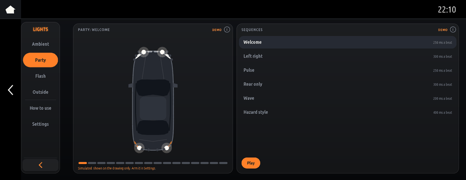
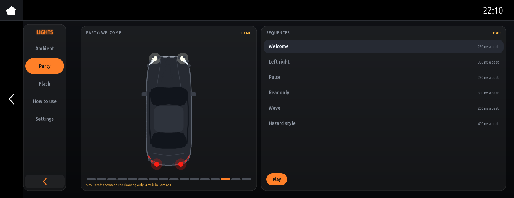
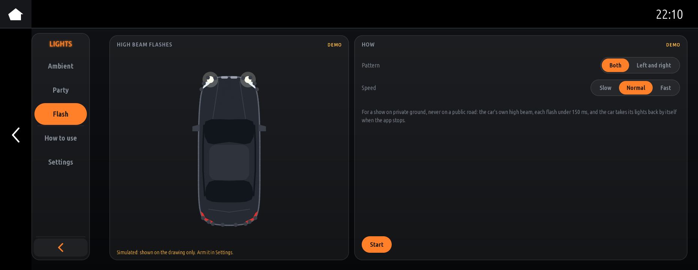
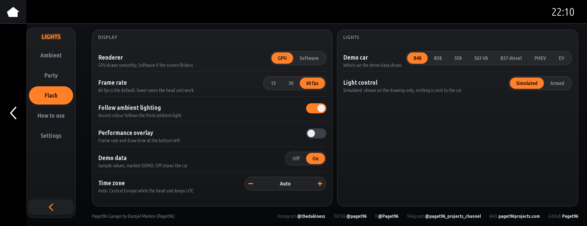

# Lights

Lights plays with the car's own lights. Ambient: any colour on the ambient light, solid, breathing, a
rainbow or a colour wave, and how bright. Party: six light sequences over the outside lamps (high
beam, cornering, fog, indicators, parking lights, brake, reverse, rear fog), only while the car
stands still. Flash: high beam flashes for a show on private ground.

Out of the box everything is simulated: the drawing shows what would happen and nothing is sent.
Settings, Light control, Armed: from then on the app switches the car's lights through the body
controller the way a workshop tester does, and the car takes them back by itself when the app
stops.

The ambient light, the sequences and the flashes come from idrive7-apps' Ambient config (MIT; the
sequences from Paget96's Exterior Lights, PR #254). Not tried on a car as Lights yet.

| Page | Screenshot |
|---|---|
| Ambient |  |
| Party |  |
| Flash |  |
| How to use |  |
| Settings |  |
