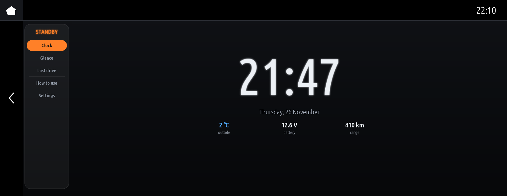
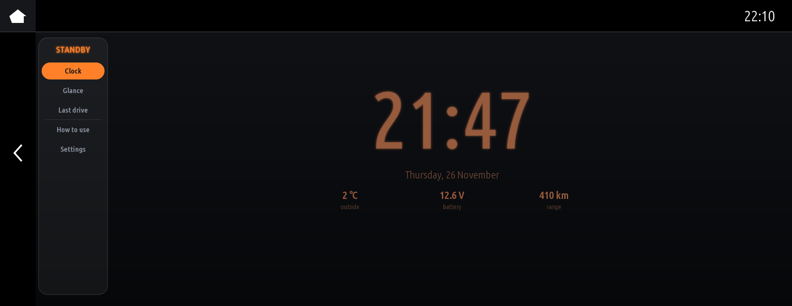
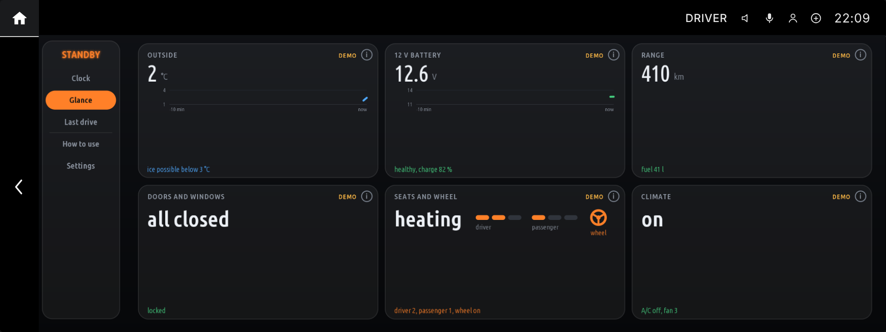
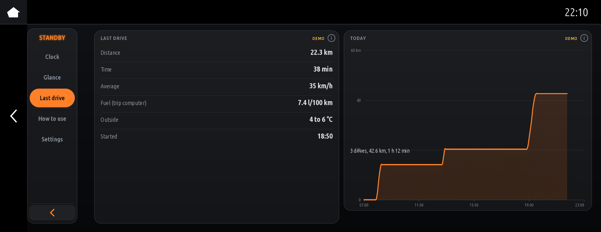
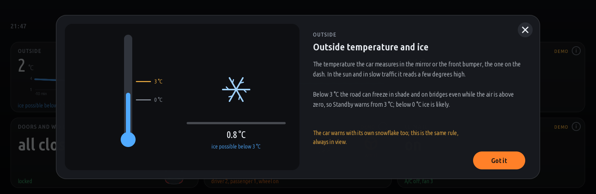
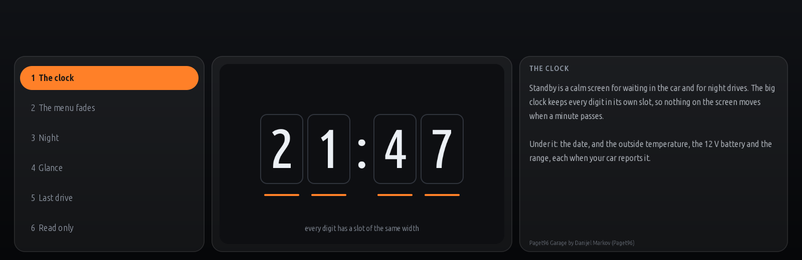
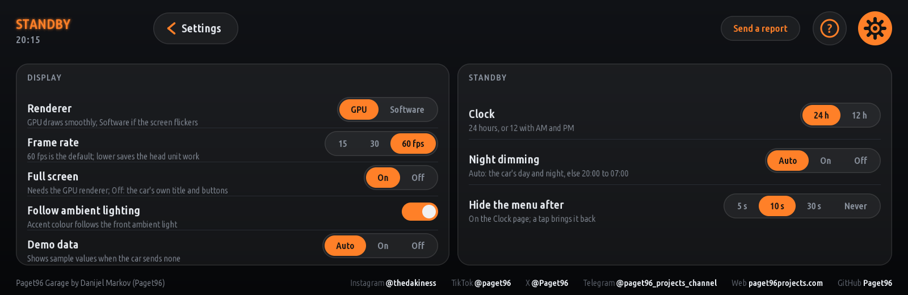
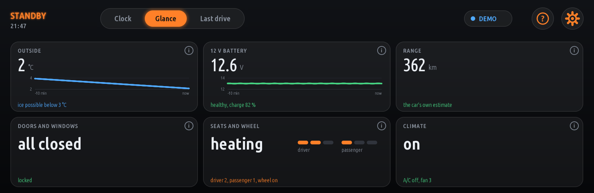

# Standby

Standby is a calm screen for waiting in the car and for night drives. A big clock whose digits never
move, the date, and under it the outside temperature, the 12 V battery and the range. After a few
seconds the menu fades out and only the clock stays; a tap brings it back. At night the clock turns
a warm dark colour. Glance shows the car at a glance, Last drive this drive and today. Standby only
reads.

| Page | Screenshot |
|---|---|
| Clock |  |
| Clock, the menu faded out |  |
| Clock at night |  |
| Glance |  |
| Last drive |  |
| Card info |  |
| How to use |  |
| Settings |  |

## Pages

- **Clock:** the time, every digit in a slot as wide as the widest digit, so nothing shifts when a
  minute passes. The date, and the outside temperature (blue when ice is possible), the 12 V battery
  and the range under it. The menu (name, tabs, buttons) fades out after the set delay; tap anywhere
  to bring it back. At night the clock dims to a warm dark colour.
- **Glance:** outside with the ice warning (possible below 3 °C, likely below 0 °C), the 12 V
  battery, range and fuel, doors (windows and the lock where the car sends them), seat and steering
  wheel heating, and the climate (on or off, A/C, fan).
- **Last drive:** this drive, or the last one: distance, time, average, the trip computer's fuel
  figure and the outside temperature on the way. Today: every drive of the day on one line.

Every card has an (i) that explains it, and How to use walks through the app.

## What it reads from the car

Only broadcast signals, except one read: the outside temperature, the 12 V charge (CDS), range and
fuel in the tank and the trip computer's average (KombiIF), speed (Vehicle2), the car's day or night
(Vehicle), the door switches (DoorsWindowsRoofMirrors), seat heating (Climate), steering wheel heating,
the climate control and A/C (ClimateMaster), the blower (Climate2) and whether the car is locked and
left (VehicleCondition). The 12 V voltage has no broadcast signal, so it is read from the engine
unit's battery sensor (22 5853) through the kit's read-only link, every 10 seconds and only while
Clock or Glance is on the screen, never while the car is locked and left.

A card, a row or a small value appears only once your car has sent its value.

## Limits

- Nothing has been tested on a car yet.
- Windows and the central lock are found by the names of the door panel's fields; whether your car
  sends them, and under which names, is not known yet. Without them the card shows the doors only.
- The distance of a drive comes from the speed signal, not the odometer: close, not exact.
- Fuel on Last drive is the car's trip computer average (trip 1), and only in l/100 km.
- Range is shown in km as the car sends it.
- Drives are kept on the head unit for today, in the app's data folder.

## Works with

Every BMW with the MGU Store on an iDrive 7 head unit, petrol, diesel, hybrid or electric: Standby shows what the car
broadcasts. On an electric car the range card has no fuel line. Settings, Demo car shows each.

## Settings

- **Renderer, Frame rate, Follow ambient lighting, Demo data:** the same in every Paget96 Garage app.
- **Clock:** 24 h or 12 h (with AM and PM).
- **Night dimming:** Auto (the car's own day and night, else 20:00 to 07:00), On or Off.
- **Hide the menu after:** 5, 10 or 30 seconds, or Never.
