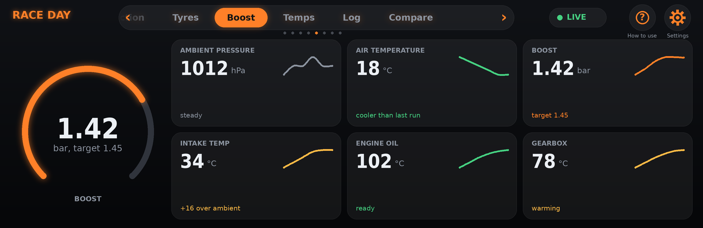
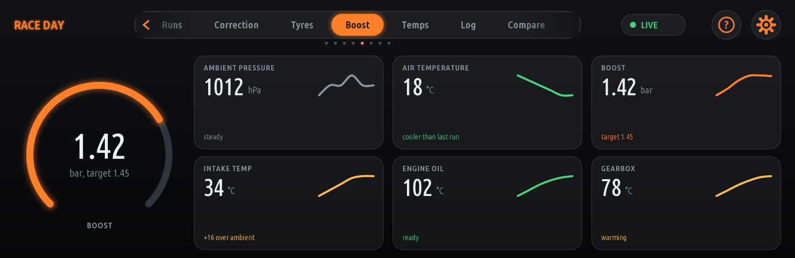
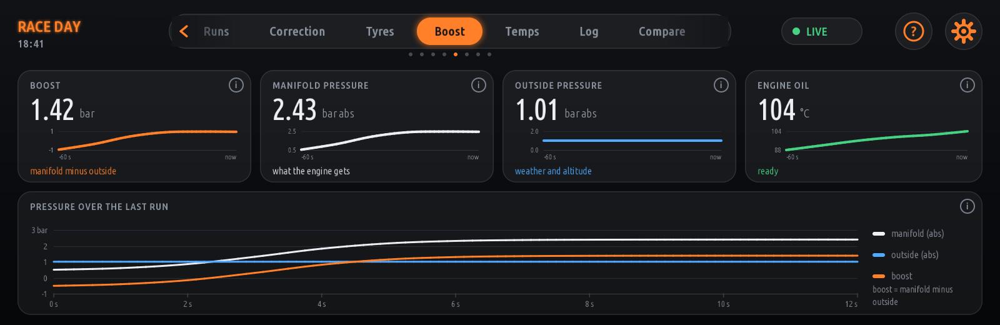
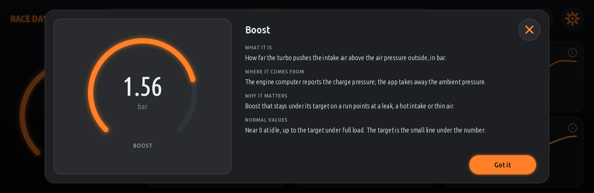
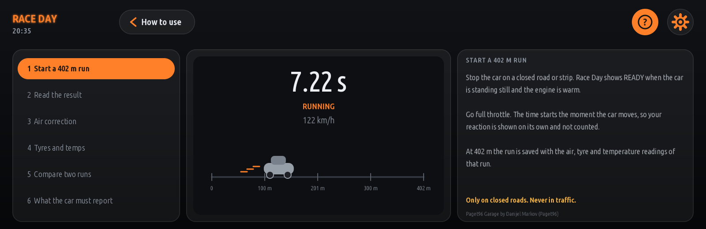
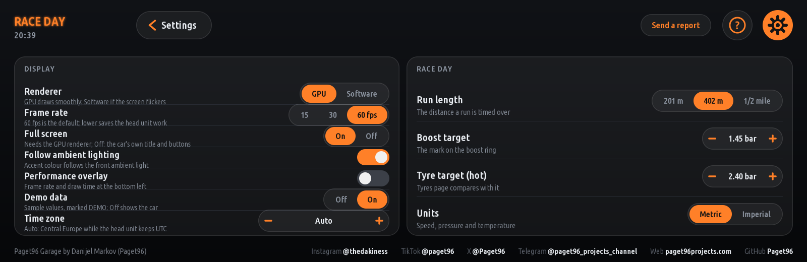

# Design: the Paget96 Garage look

Every Paget96 Garage app looks like this (owner, 2026-11-26 16:54 to 16:56: layout B, top tabs; later the same
day: scrolling tabs, the two buttons top right, round ends everywhere). The rule: "Every app interface
must be modern, never as plain as the upstream iDrive apps."

Reference, drawn as the target: 
(the first version without scrolling tabs and buttons: [ui-B-toptabs.png](design/ui-B-toptabs.png))

The same page drawn by `lib/ui.js` (`node tools/ui_demo.js`, the head unit's software path):


The other standard pieces, drawn the same way:

| Chart axes and card charts | Info popup |
|---|---|
|  |  |
| **How to use** | **Settings** |
|  |  |

## Layout (1600 x 520)

| Part | Where | Look |
|---|---|---|
| Background | whole page | vertical gradient (16,18,22) to (6,7,9) |
| App name | top left, x 28, baseline 44 | bold 24, orange, soft orange glow |
| Tabs | glass bar x 270 to 1170, y 12, 56 high | pills; the selected one filled orange with a glow and dark text, the others dim. Many tabs scroll sideways: the ends fade out, round-ended arrows (left, right) show where there is more, position dots sit under the bar, the selected tab glides into view, and the iDrive knob goes through all tabs |
| Status pill | glass pill 130 x 44, left of the two buttons (x 1250) | a dot and LIVE (green) or demo |
| How to use, Settings | round glass buttons, r 30, flush right at the title's margin (28 px): Settings centred at x 1542, How to use at 1462; the Settings button's right edge is the content cards' right edge | "?" and a gear in the accent colour, no labels under them; on its own page a button is lit (filled, dark glyph). Both pages are mandatory in every app |
| Hero ring | left column, centre (200, 300), r 150 | dark track, orange arc with glow over 270 degrees, the number large in the middle, a unit line, an uppercase label below. Only where an app has one main number |
| Cards | right of the ring, 3 x 2, 386 x 200, 14 px apart | glass: white 6 % fill, 10 % outline, radius 22; uppercase dim label, big condensed number, small unit, a coloured one-line status, a sparkline on the right |

Status colours: green (70,210,130) ok, amber (255,186,70) warming, orange (255,128,40) accent, dim
(140,148,160) neutral, red bad, blue info. Text (236,240,245).

## lib/ui.js

Built on upstream's kit only (`canvas.js`, `record.js`, `gauges.js`), so it draws through the same
frame surface as every kit widget: the GPU renderer at 60 fps, or the software canvas.

| Call | Draws |
|---|---|
| `background(cv)` | the gradient |
| `title(cv, name)` | the app name with its glow |
| `tabs(cv, items, sel, { onSelect })` | the tab bar, scrolling when needed; returns the tab rects and adds a touch and knob target per tab. Draw it right after `background()` |
| `nextTab(sel, n, step)` | the next or previous tab, round the end (for an app that turns the knob itself) |
| `header(cv, { status, statusColor, onHelp, onSettings })` | status pill and the How to use and Settings buttons |
| `status(cv, label, note, color)` | LIVE / demo as plain text (a page without the header) |
| `bar(cv, x, y, w, h, frac, color, key)` | a progress bar with round ends; with a key the fill glides |
| `curve(cv, pts, width, color)` | a smoothed line with round caps and joins |
| `card(cv, x, y, w, h, label, { info })` | a glass card; with `info` a small (i) top right and the whole card opens the info popup |
| `stat(cv, x, y, w, h, { label, value, decimals, unit, sub, color, history, info, minSpan, seq })` | a stat card: the number glides, the small chart is a strip under it with its range and time span |
| `ring(cv, cx, cy, r, { value, min, max, text, unit, label, color, scale, target, info })` | the hero ring: the arc and number glide; optional scale and target mark |
| `pill(cv, x, y, text, color, filled)` | a status pill |
| `chart(cv, x, y, w, h, series, { label, info, min, max, yTicks, yUnit, xLabels, legend, note, seq })` | a chart card with axes: round y numbers with the unit on the top one, x labels, a legend |
| `segmented(cv, right, cy, options, value, onChange)` | a segmented choice; the selected pill slides |
| `toggle(cv, right, cy, on, onChange)` | a switch; the knob slides |
| `stepper(cv, right, cy, value, { decimals, unit, onMinus, onPlus })` | minus, the value, plus |
| `infoPopup(cv, info, t)`, `openInfo(info)`, `closeInfo()`, `overlay(cv, t)` | the info popup (below) |
| `dialog(cv, d, t, { a })`, `dialogButton(cv, right, y, label, kind)` | a dialog over the page (confirm, pick, a result): a coloured label, heading, text, note, chips and buttons (`kind` `bad` red for what cannot be undone, `primary` accent); while it is open only its own buttons can be pressed. It fades and scales like the info popup |
| `howToUse(cv, topics, sel, t, opts)` | the whole How to use page (below) |
| `settingsPage(cv, appRows, values, onChange, opts)` | the whole Settings page (below); `DISPLAY_SETTINGS`, `DISPLAY_DEFAULTS` |
| `niceRange(lo, hi, n)`, `fmtTick(v, step)`, `wrap(cv, text, size, width)`, `anim(key, target, ms)`, `glide(key, v)` | helpers for new widgets |
| `spark`, `glass`, `glowRoundRect`, `glowArc`, `glowText` | the parts, for new widgets |

## Smooth motion at 60 fps

Owner, 2026-11-26 17:48: every chart, progress bar, ring, number change, popup, tab change and animation
is smooth at 60 fps. Nothing jumps.

- Numbers, rings and bars glide to a new value (the kit's spring, `gauges.smooth`). Pass `smooth: false`
  for a value that must show the exact sample.
- Charts move instead of redrawing in steps: give `seq`, the number of the newest sample, and when it goes
  up the lines slide left by one step. A small chart's range glides too.
- The selected tab pill slides to the new tab; a segmented choice slides its pill; a switch slides its knob
  and fades its track.
- The info popup fades and scales in and out over about 200 ms.
- Motion is time based, so it looks the same at 15, 30 or 60 fps.

To keep 60 fps on the head unit, everything static is a cached layer, a frame records only what moves,
and the line drawing reuses its point buffers instead of making new arrays every frame. A new widget
follows the same rules.

## Every chart shows its values

Owner, 2026-11-26 17:33: axes with numbers and units on every chart.

- `chart()`: the y axis is rounded out to whole steps of 1, 2, 2.5 or 5 (`yTicks` is about how many), the
  numbers sit left of the grid and the top one carries the unit (`yUnit`, "3 bar"). `xLabels` are spread
  under the plot ("0 s" .. "12 s", "-10 min" .. "now"). Named series get a legend at the bottom or, with
  `legend: 'right'`, in a column on the right with an optional `note` under it.
- `stat()`: the small chart is a strip across the card under the value, with its top and bottom value on
  the left and "-60 s" and "now" under it (`spanLabel`, `nowLabel`). It never zooms in past `minSpan`
  (default 2) or 1 % of the value, so a tiny wobble does not look like a big swing.
- `ring()`: `scale: { step, decimals }` (or a list of values) draws ticks and numbers outside the arc;
  `target` marks a value across the track with a round-ended line.

## The (i) and the info popup

Owner, 2026-11-26 17:35: every card has a small (i) top right. Give a card, stat, chart or ring an `info`:

```js
const info = {
    label: 'Charge air', title: 'The air that goes into the engine',
    text: 'Where it is measured and how it works.\n\nWhy it matters.',   // paragraphs split by a blank line
    note: 'Normal: 10 to 25 °C above the outside air under load.',
    draw: (cv, x, y, w, h, t) => { /* the illustration; t in seconds, so it can animate */ },
};
UI.stat(cv, x, y, w, h, { label: 'Charge air', value: 38, unit: '°C', info: info });
// ... the rest of the page, then, last in the frame:
UI.overlay(cv, t);
```

The whole card is then a touch and knob target. Tapping it opens the popup: the page dimmed, a panel with
the illustration on the left and the label, heading, text and note on the right, a round X and a "Got it"
button, both of which close it. While it is open only those two can be pressed. `infoPopup(cv, info, t)`
draws it directly (fully open), for a preview or an app that keeps its own state. An app that keeps the
popup in its own state passes `onInfo` (a function) instead of `info`; `info.sections` (`[{ head, text }]`)
works in place of `text` and `info.art` in place of `draw`.

Every card in every app gets an `info`: the rule is an (i) on every card, and an (i) that opens nothing
would be a dead control, so the (i) is drawn exactly when there is something to open.

## How to use

`howToUse(cv, topics, sel, t, { title, onSelect, onBack, onSettings })` draws the whole page: a back pill
"How to use" in place of the tabs, the ? button lit, the topics on the left (numbered, the selected one
slides), the topic's illustration in the middle (`topic.draw(cv, x, y, w, h, t)`, animated) and its text
on the right, with a note in amber and, at the bottom, the credit line "Paget96 Garage by Danijel Markov
(Paget96)" that every copy keeps (NOTICE). `topics = [{ title, text, note, draw }]`.

## Settings

`settingsPage(cv, appRows, values, onChange, { title, appLabel, onBack, onHelp })` draws the whole page:
a back pill "Settings", the gear lit, the Display card on the left and the app's own card on the right.

The Display card is the same in every app (owner, 2026-11-26 17:39), from `UI.DISPLAY_SETTINGS`:

| Key | Setting | Choices | Default |
|---|---|---|---|
| `renderer` | Renderer | GPU (`auto`) / Software | GPU |
| `fps` | Frame rate | 15 / 30 / 60 fps | 60 |
| `followAmbient` | Follow ambient lighting | switch | on |
| `demo` | Demo data | Auto / On / Off | Auto |

The entries have the shape upstream apps use for `"settings"` in `app.json` (`key`, `label`, `type`,
`default`, `options`), so an app copies them there, first, and adds its own after them. `hint` is the
line under the name on this page. App rows use the same shape: `type` `choice` (a segmented choice),
`bool` (a switch) or `number` (a stepper through `steps`, or `min`, `max`, `step`, with `unit` and
`decimals`). A missing value shows the default; every control calls `onChange(key, value)`.
`UI.DISPLAY_DEFAULTS` holds the defaults by key.

## Round ends everywhere

Owner, 2026-11-26: every progress bar, arc or ring end and every chart line has fully round ends.
Arcs use the kit's `{ round: true }`, bars are pills (radius h / 2), lines go through `curve()`:
Catmull-Rom smoothing, then `stroke()`, whose segments have round caps, so joins are round too. No
square ends anywhere.

`color` takes a status name (`ok`, `warm`, `accent`, `dim`, `bad`, `info`) or a `#hex`.

**Speed.** The renderer has no blur, so a glow is a halo of 8 stacked shapes with falling alpha.
Everything static (background, title, tab bar per selection, card glass and label, ring track and
label, chart grid) is a cached layer (`gauges.layer`), drawn into a texture once; a frame records only
numbers, sparklines and the ring's arc. `tools/ui_demo.js` reports the recording time of a frame
(about 0.3 ms on a PC for the reference page).

**In an app** the file ships as `garage_ui.js` beside `main.js` (`tools/build.py` copies it):
`const UI = require('./garage_ui');`. Node 8 only syntax.

A widget an app needs goes into `lib/ui.js` and this table, never into one app.

## Follow the ambient light (owner, D11)

The UI accent (the orange of tabs, ring, buttons, title) follows the colour of the car's FRONT
ambient light (the area around the dashboard), so the screen matches the cabin. Only `C.orange` /
`C.amber` change at run time. **The icons always stay orange.**

Where the colour comes from, in order:

1. The front colour the Ambient config app saved (its `look` setting), if our apps can read it. (unsure:
   not checked yet whether one app can read another app's settings on the head unit)
2. The car's own colour: `ComfortFunctionIuK.statusAmbientLightInteriorColour` gives the slot (1 to 12)
   of BMW's menu; a table maps the slot to a colour. Which colour a slot is depends on the car, so the
   table is checked on a real car before it ships.
3. Orange.

Never read the light modules over LIN for this: the read holds the gateway for seconds, fights the
Ambient config app's writes, and hangs some body modules (upstream #197).

**Live, with the driving modes (owner, 17:18, D13).** The accent changes when the front colour
changes, also when the Ambient config app changes it for a driving mode: the car's own colour slot
signal changes with it, and for its own per-mode looks the app's saved `mode_<mode>` look is read for
the mode the car reports (`FES statusFESVehicleDynamicSwitchHMI`), if readable. The accent glides
to the new colour (about 0.5 s). Short overlays (turn glow, open door red, strobe, welcome) are
ignored so the UI does not blink.

**Only the chrome follows (owner, 17:19, D14).** `C.accent` is the chrome: title, selected tab, tab
arrows and dots, the button glyphs. Every chart, sparkline, ring, gauge, bar, pill and status text
keeps its fixed colour (`C.orange`, the status colours), because red means the limit or bad, amber
warm, green ok, and that must never change with the cabin light. When the accent becomes live, the
cached chrome layers must carry the accent in their cache key.

A colour too dark, too pale or too close to the status colours (green ok, amber warming) is adjusted
in lightness so text and charts stay readable. On by default, with a setting "Follow ambient lighting" to turn it off
(owner, 17:13). Every app has it on its Settings page.
